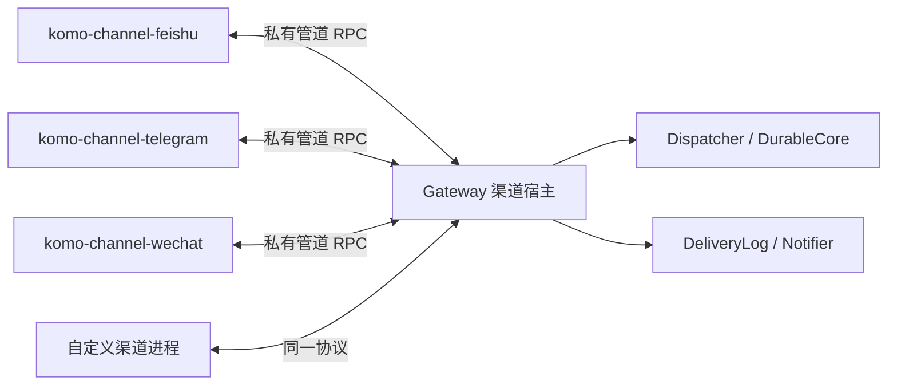

# 渠道插件

## 1. 需求背景

新增渠道不应修改核心枚举、Gateway、CLI 和发布代码。飞书、Telegram、微信也全部移出 Gateway，成为同仓维护、独立编译运行的可执行插件；主程序不链接它们的 SDK 或渲染代码。

本次保留现有身份、会话、话题、插话、图片、卡片、微信登录和投递账语义。没有数据库迁移，不新增插件市场或语言运行时。

## 2. 方案概览

### 整体设计



所有渠道代码统一放在 `crates/komo-channel/`。公共协议、runner、inbox 在 crate 根；飞书、Telegram、微信分别在 `src/feishu/`、`src/telegram/`、`src/wechat/`，入口在 `src/bin/`，产出三个独立插件程序。该 crate 不依赖 runtime、store、Gateway。

默认不开平台 feature，Gateway 只使用公共协议。插件构建显式开启 `feishu,telegram,wechat`；核心和插件分两次 Cargo 调用构建，避免 Cargo feature 合并把平台 SDK 拉进核心构建。

### 核心流程

1. Gateway 按配置创建通用进程适配器；后台启动插件，不阻塞 Gateway 就绪。
2. describe 核对渠道 ID 和协议版本，initialize 只传该渠道配置、目录与所需凭证。
3. start 后接收入站；宿主完成准入与受理后回 InboundAck，插件再按平台规则确认。
4. 发往平台的持久投递仍先写投递账，再经通用发送口交插件；重试带同一个 DeliveryId。
5. 配置变化停止并等待旧接收进程退出，再起新进程；异常退出撤发送口并退避重建。

### 改动清单

| 模块 | 职责 |
|---|---|
| komo-channel 公共模块 | 收发契约、上下文、RPC、进程 runner、图片收件箱 |
| komo-channel::feishu | 飞书 SDK、ws、话题、图片、名字解析、卡片与渲染 |
| komo-channel::telegram | Bot API、轮询、图片与渲染 |
| komo-channel::wechat | iLink、回复令牌、登录、图片与渲染 |
| Gateway channels | 通用进程工厂、注册表、生命周期、入站来源校验 |
| kernel / runtime config | 开放渠道标识、动态配置、凭证指纹与校验 |
| CLI / release / install / update | 通用登录、四个可执行文件的成套分发 |

## 3. 详细设计

### 模块设计

插件只知道平台 peer，不决定 Session、不执行聊天命令，也不开数据库。宿主保留 allow_from / allow_tenant 判定、home 路由、命令、插话、Run 与投递账。

入站私聊且无 thread 时继续进入 home；带 thread 或群聊按 peer 定位会话。飞书保留历史上下文和卡片关联，微信保留进程内 context_token。图片继续通过共享收件箱落工作区，正文带路径；不改变核心多模态协议。

官方插件默认从主程序所在目录的 `komo-plugins/<主程序版本>/` 查找。源码开发的 `target/debug/` 没有版本目录时，使用同目录的插件可执行文件。自定义插件使用配置中的绝对路径，不搜索未知目录或动态库。

### 关键逻辑

- 平台标识支持最长 64 字节的小写字母、数字、`_`、`-`，且以小写字母开头。旧的四个 ID 与序列化保持不变，其他合法 ID 无须登记即可解析。
- 原有三个配置字段保留解码与调用兼容，其他渠道通过动态集合加入；home 候选保留飞书、Telegram、微信顺序，其他渠道按 ID 追加。
- 插件提交的 peer.platform 和请求键前缀必须匹配宿主给它的渠道。`api` 是保留入口，插件不能以它绕过聊天准入。
- 进程通信使用独立读循环处理响应，即使插件正等入站回执，也能接收并处理 send，避免双向调用死锁。
- 单帧最多 1 MiB，接收队列和在途请求各最多 64，调用超时 60 秒。坏帧、队列溢出或连接关闭使在途调用失败；取消可能中断帧写入，整条连接随之关闭，不复用半帧流。
- 停止先撤发送口，取消接收，等待 shutdown；插件接收任务最多等待 5 秒，宿主等待进程最多 5 秒，监督器总等待最多 12 秒，超时终止并回收。异常重启从 1 秒退避，最多 60 秒。
- 名单变化仍只影响该渠道；凭证指纹变化也会重启对应进程。新增和删除自定义渠道参与重载；删掉的渠道不会继续运行。
- 平台告警通过宿主的 home 通知通道发送。微信失去登录态、连续解析失败仍沿用原告警行为。

### 异常处理

缺少插件、握手不匹配、缺凭证或平台连接失败只影响该渠道，其他入口继续服务。发送失败保留投递记录，微信没有回复令牌仍返回 Deferred。probe 不启动消费循环；login 是 CLI 启动的交互子进程，不打开数据库，也不要求模型配置先通过验证。

### 兼容性设计

旧 `[channels.feishu]`、`[channels.telegram]`、`[channels.wechat]`、`.env` 变量、微信凭证文件和已存 peer 字符串原样使用。旧微信登录命令保留为通用登录的别名。

运行中的旧 Gateway 不会因更新磁盘文件切换进程；安装本地版本的默认重启行为不变，`komo update` 仍只提醒重启。

## 4. 数据与接口变更

### 存储变更

无数据库 DDL、迁移或历史记录重写。SDK 的凭证容器 Debug 只显示变量名；值只通过父子私有管道传递。

新增渠道示例：

```toml
[channels.discord]
enabled = true
allow_from = ["123456789"]
home_chat = "987654321"

[channels.discord.plugin]
command = "/opt/komo-channels/komo-channel-discord"
args = []
env = ["DISCORD_BOT_TOKEN"]
```

凭证值仍写 `.env`。`plugin.env` 是凭证名清单，用于授权向自定义插件提供凭证、配置校验及热重载指纹。自定义插件 describe 中请求了清单之外的凭证时，握手失败。原三个官方插件继续使用原凭证名。

### 接口变更

双向 JSON RPC，每帧为 4 字节大端长度加 JSON。帧字段为 id（u64）、method（请求时为字符串，响应时省略）、payload（JSON）和 error（失败响应的字符串）。两边各自分配请求 ID，响应仅结算本端待响应表。

| 方向 / 方法 | payload | 返回 |
|---|---|---|
| 宿主 → describe | null | version、channel、credentials 变量名数组 |
| 宿主 → initialize | version、channel、context、secrets | 同 describe；版本或渠道不匹配则拒绝 |
| 宿主 → start | null | null；构建失败返回错误 |
| 宿主 → send | delivery_id、peer、outbound | status=sent 或 status=deferred + reason |
| 宿主 → probe | null | 探测结果字符串 |
| 宿主 → shutdown | null | null；停止接收并退出 |
| 插件 → inbound | kernel InboundMessage | kernel InboundAck |
| 插件 → alert | 告警字符串 | null 或通知失败错误 |

context 只有 config（当前 ChannelConfig）、data_dir、workspaces_dir；不发送完整 ConfigSnapshot。secrets 是该插件声明、宿主允许的变量名到值的映射。send 的 peer 与 outbound 沿用 kernel 的 JSON 类型。平台无幂等键时，DeliveryId 只提供稳定身份，不能保证发送回执丢失后绝不重复。

CLI：保留 `komo channel list/probe`，增加 `komo channel login <渠道>`；`komo channel wechat login` 是兼容别名。插件提供 `--describe`、`--version`，微信另外支持交互的 `login <数据目录>`；无交互登录的插件明确报不支持。

## 5. 可靠性与安全

### 监控告警

沿用日志和投递监控；进程退出及重建失败记录渠道与原因。平台健康告警送 home；启动失败不会假报连接正常。此轮未新增后台服务或监控数据库。

### 流量评估

没有采集真实平台吞吐，不承诺吞吐提升。有限队列、帧上限和超时限制进程通信的资源增长；附件不经过大 JSON 帧。投递账仍保留原串行补发锁。

### 降级与兜底

一个插件失败只撤自己的发送口，宿主继续运行。投递记录在可用后补发，缺 home 时仍明确报错。插件进程重启会丢微信的进程内回复令牌，直到下一条消息到达；该限制与旧 Gateway 重启语义一致。

### 安全合规

独立进程是故障隔离，不能代替 OS 沙箱；只运行操作者明确安装或配置的可信程序。父进程清空插件继承环境，只保留基础环境、代理设置和该插件获准的凭证，不传完整 Secrets 或 Gateway 管理 token。平台应用开通与授权仍需在对应平台完成。

## 6. 上线方案

### 发布步骤

`cargo build -p komo` 构建核心，`cargo build -p komo-channel --features feishu,telegram,wechat` 构建三个插件；发布包名和 SHA256SUMS 约定不变，包内是四个明确命名的普通文件。release workflow、install.sh、install-local.sh 和 updater 同步识别它们。

安装器验证主程序和全部插件版本后，先准备版本目录里的整套插件，用目录软链的一次 rename 切换插件集合，最后原子替换主程序。版本目录保留旧集合；普通更新不会删除它。没有自动安装、发布或重启线上实例。

### 灰度策略

先运行工作区回归及本地假平台、真实子进程测试，再由操作者安装并做三个真实账号的收发验收。本轮不访问真实平台账号、不发送真实消息。

### 回滚方案

保留旧主程序和对应插件版本目录即可恢复相应版本；本地同版本安装保留上一代插件目录，可把版本软链指回它。新平台记录产生后，回到不认识该平台的重构前程序可能无法解码相关记录，不承诺这种跨协议回滚；不改写或删除数据来回滚。

### 验证计划

- `cargo fmt --check`、`cargo check --workspace --all-targets`、`cargo test --workspace`。
- 原渠道单测与 Gateway 集成回归继续覆盖话题、图片、卡片乱序、插话吸收、微信令牌与登录。
- 真实 fixture 子进程覆盖双向并发、协议不匹配、崩溃、宿主桥接与冒充 api 被拒。
- 更新器覆盖完整插件包及版本检查，shell 安装脚本做语法检查；真实账号与 Linux 安装仍需真机验收。
- `cargo tree -p komo --edges normal` 不得出现 openlark、wechatbot、qrcode；`cargo tree -d` 比较锁文件中的外部包版本。
- 结束时运行 `cargo build --timings`，实测结果写回 `komo_bot.md` §14。

本机结果（2026-10-30）：工作区测试 2516 通过、0 失败、12 跳过，收尾修正后宿主桥接 2 项再次通过；核心与三个插件分别构建通过，CLI 帮助及三个 describe 已运行；格式、diff 和 shell 语法检查通过。外部依赖版本无增删，核心依赖树不含平台 SDK。构建计时及未验证的真机范围记录在 `komo_bot.md` §14。

## 7. 影响范围

- ☑ 渠道实现、渲染、进程通信、配置集合与重载、CLI、分发安装更新、相关测试及设计规范。
- ☐ 不改变 durable 提交线、数据库所有权、Agent loop、工具执行、确认和记忆系统。
- ☐ 不自动安装本机版本、重启正在运行的 Gateway、访问平台账号或发布远端版本。
