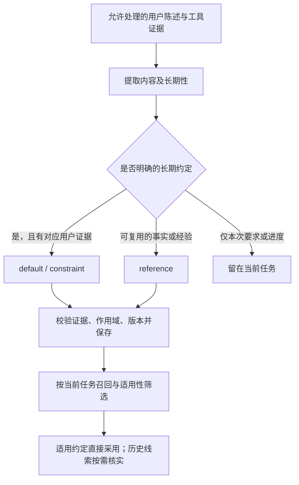

# komo Memory

> 状态：§9.1–§9.7 是 Memory 的**规格**，2026-10-19 从 [`komo_bot.md`](komo_bot.md) §9 原样迁来，小节号不变——代码注释与其他文档里的 §9.x 照旧指这里。§9.8–§9.10 已实现（§9.10 含 `used` 采纳）。各节标"2026-10-28，附录 F"的段落（约定与线索、相关度门槛、注入分组、索引输入含条件、`classify`）已于 2026-10-28 实现并通过验收（见 §9.4「附录 F 的实现与验收」）。附录 A–F 是调研、分析与评估，不是规格；与正文冲突时以正文为准，任何一条要落地，先改正文。
> 2026-10-25 起 Memory 跑在新存储上（`docs/storage-durable.md`）：条目 / 证据 / 索引 / 采纳计数在 `aux.db`（toasty，与 `durable.db` 分库），会话内容是 `durable.db` 的 entry，证据引用仍是 `Seq` / `RunId`（新编码，`komo-kernel/src/durable/legacy_ids.rs`）；注入是系统段 `memory` + 会话级 document `komo.memory`，提取游标是 document `komo.memory_cursor`，提取读的是 entry / submission 经 `legacy_events` 投影出的事件。正文里仍写"事件""Run""`memory.injected`"的地方指这层投影的词汇，不再是 JSONL 事件。
> 文中不带文件名的其他章节号（§3、§8.2、§8.5、§10 …）指 [`komo_bot.md`](komo_bot.md)。附录内的编号只在本附录内有效。

| 节 | 内容 | 状态 |
|---|---|---|
| §9.1 | 两类内容，分别保存 | 规格 |
| §9.2 | 记忆的数据模型 | 规格 |
| §9.3 | 自动积累与更新 | 规格 |
| §9.4 | 关键词与向量混合检索 | 规格 |
| §9.5 | 向量索引与模型切换 | 规格 |
| §9.6 | 冲突、失效与遗忘 | 规格 |
| §9.7 | 与 resume 和权限的关系 | 规格 |
| §9.8 | 离线整理 | 已实现 |
| §9.9 | 判关系时候选用编号 | 已实现 |
| §9.10 | 按会话提取，一次调用 | 已实现（含 `used` 采纳） |
| 附录 A | 外部记忆仓库调研（graphiti / mem0 / OpenViking） | 2026-10-19 |
| 附录 B | 记忆机制改进方案（原 `docs/memory-improvements.md`） | 2026-10-16 提案 |
| 附录 C | 对照 v0.8 的差距分析（原 `docs/memory.md`） | 2026-09-24 分析 |
| 附录 D | 记忆效果基线：注入有没有用、该召回的召回了没有 | 2026-10-19 回溯评估 |
| 附录 E | Claude Code 的记忆机制（官方文档核对） | 2026-10-26 调研 |
| 附录 F | 长期约定与历史线索的使用模型 | 2026-10-28 提案；已并入 §9.2–§9.8 正文，已实现（§9.4 验收记录） |

## 9.1 两类内容，分别保存

| 内容                               | 保存位置                                      | 使用方式                                                  |
| ---------------------------------- | --------------------------------------------- | --------------------------------------------------------- |
| 用户主动要求保存的笔记、想法和记录 | 现有 Memos                                    | 通过 Memos skill 的脚本（`bash` 运行）保存、搜索和读取，返回原文链接 |
| 自动积累的偏好、项目事实和执行经验 | 本机 `aux.db` 的 memory_items / memory_evidence | MemoryManager 提取、校验、召回、更新和遗忘；用户说"记住"时也可 `komo memory add` 当场记一条（§9.3） |
| 本次任务的工作状态                 | Session / Run / ToolCall                      | 用于上下文与 resume，不自动等同于长期事实                 |
| 关键词与向量索引                   | 同一个 `aux.db`                                 | 从有效记忆重建，不能取代原文与来源                        |

长期记忆和当前激活的上下文分别管理：Context Window 是模型请求的容量限制；Working Memory 是本次任务实际选入的历史、状态、相关记忆和工具结果。不能把整个记忆库塞进每轮请求。

首版向量检索覆盖自动 Memory，以及其中已经保存的 Memos 来源摘要。它不表示已索引全部 Memos 内容；查找主动笔记仍查询 Memos。Memos 全量语义索引需要另行明确导入范围，当前不增加同步器。

## 9.2 记忆的数据模型

确认状态与来源分开保存，避免把“模型从用户原话整理”误写为“用户确认了模型摘要”。

| 字段                      | 含义                                                                                  |
| ------------------------- | ------------------------------------------------------------------------------------- |
| id / revision             | 稳定 ID 与递增内容版本；修改产生新版本                                                |
| content / kind            | 简短、尽量单一的陈述；preference / fact / experience                                  |
| application / applies_when | 怎么用：convention（长期约定）/ reference（线索），NULL = 旧条目尚未分类；applies_when 是约定适用的条件，短文本 |
| scope                     | personal、project、environment 或 agent，绑定当前操作者、稳定项目 ID、实例 ID 或某个 Agent |
| provenance                | user_statement / tool_observation / model_inference                                   |
| confirmation              | unconfirmed / user_confirmed                                                          |
| state                     | candidate / active / contested / superseded / forgotten                               |
| evidence_refs             | JSONL 的 Session ID + event_id / seq、工具产物或 Memos 实例 / 记录 ID、时间与来源版本 |
| observed_at / valid_until | 事实的观察时间与可选有效期，区别于入库时间                                            |
| created_at / updated_at   | 记忆管理时间                                                                          |
| extraction_metadata       | 提取模型、effort、提示词版本、处理来源游标                                            |
| usage                     | 注入次数与最近注入时间；用上次数（`adopted_count`）与最近用上时间（§9.10），只度量使用情况，不增加真实性 |
| supersedes / superseded_by | 取代了谁 / 被谁取代（id + revision）；前者挂在新条目，后者挂在每条被取代的旧条目      |

证据与内容版本分别保留。用户确认绑定具体 id / revision 和操作者事件；模型返回的 user_confirmed 字段没有写入权限。明确的用户原话可标为 active + user_statement + unconfirmed，展示为“自动整理自用户陈述”；模型推断默认 candidate，不作为已确认事实注入。

用户主动保存到 Memos 表示“要求保留这段内容”，其中可能有引用、假设或待办，不等于确认了其中每一句话。只有用户明确确认的具体陈述才能获得 user_confirmed。

**约定与线索（2026-10-28，附录 F，已实现）。** kind 说内容是什么，provenance 说从哪来，confirmation 说用户有没有复核过这一版的文字——三者都不回答"这条该怎么影响行为"。用户说过"以后发布工单 Platform 都选 saas"，记成 active + user_statement + unconfirmed 之后，旧的注入把"未确认"读成"先问用户"，同一个默认值每次都要再问一遍。所以使用方式单独一格：

| application | 使用 | 谁能产生 |
|---|---|---|
| convention | `applies_when` 成立、且本次没有另外指定时**直接照做**；用户当次说了别的，以当次为准，长期约定不变 | 只用于 preference；必须有用户陈述证据（提取或 Agent 代记），或操作者在终端里亲自写入 |
| reference | 查找与判断的线索；易变的事实结合当前证据核实；不能扩大当前任务，也不能凭它替用户形成新约定 | 其余一切：fact / experience、工具观察、助手报告、模型推断 |
| NULL | 旧条目尚未分类，按 reference 使用 | 加列之前的条目；读取时不静默改写 |

- convention 的 `applies_when` 必填，写成一句能独立理解的条件（"创建发布工单、需要选 Platform 时"）；reference 可省。条件不是作用域也不是权限：正文或条件写着"适用于所有人"不扩大 scope。
- convention 的默认值与限制（"这个仓库不改全局 Git 配置"）不再分成两类：两者都是"条件成立就照做、当次另说以当次为准"，分开只给提取模型多一个要分错的类。
- **unconfirmed 不阻止 convention 生效**：confirmation 仍只表示用户是否复核过这一版文字。active + user_statement + convention 在 unconfirmed 时照常作为约定使用；模型不能把它改成 user_confirmed。candidate 不因带了 application 就绕过生命周期进入自动注入。
- 改 application 或 applies_when 是内容语义变化：升 revision，证据保留，旧注入的引用失效（§9.4、§9.7）。
- 只有用户表达了长期意图的才是 convention；"这个工单选 saas""这次用 terra 并行做"是当次要求，留在当前任务，不入库（§9.3）。

**`agent:<id>` 是那个 Agent 的私有作用域（2026-10-22）。** 只有 Profile 写 `memory = "private"` 的那个 Agent 召回、提取得到它；不限作用域的召回与提取候选（`shared` 且没写 `memory_scope`）放行除 `agent:*` 之外的全部；两路检索都在排名、截断之前按作用域过滤（`scope_allowed`），一个作用域灌再多也挤不掉别的作用域的候选名额。`private` 的提取结果一律落在 `agent:<id>`，模型交回别的作用域也改写过去；`shared` 的提取交回 `agent:*` 丢弃。用途是给别人用的 Agent：别人的话只进它自己的记忆，碰不到操作者的，也不会被操作者的 Agent 召回成一条注入通道。操作者的 CLI 显式 `--scope agent:<id>` 照常读写。

NAS 和 Mac 的自动 Memory 各自独立。项目作用域使用实例内稳定的项目 ID，可映射多个临时仓库副本；工作路径相似不自动意味着同一项目。

## 9.3 自动积累与更新

MemoryManager 对 AgentRuntime 提供三个主要入口：recall、process_completed_run、apply_user_decision。提取、去重、证据校验、冲突处理与索引协调隐藏在该模块内部；它不向 LLM 注册额外工具。

处理流程：

```text
输入 submission 结算后，这条 run 就是一份待提取的工作（`skip_memory` 的、任务会话与 Cron 的不调模型）；游标在会话级 document `komo.memory_cursor`
  → 会话空闲满 `[memory].extract_idle` 后，后台一次领走该会话全部尚未处理的 Run（§9.10）
  → 提取前整批召回已有记忆一次（§9.10）
  → 记忆模型一次调用提取结构化候选并判与编号旧条目的关系，不提供执行工具
  → Rust 校验来源角色、引用位置、作用域与内容
  → 准备内部 Memory 变更计划
  → 按来源游标与预期 revision 事务提交
  → 标记相关索引待更新
  → 后台生成向量，确认版本未变后入库
```

每个 run 的处理游标（`{runs: {RunId: {work, cursor}}}`，`work` 为 pending / done / error）记在 conversation 级 document `komo.memory_cursor`，`finish` 经 engine 提交读改写，游标只进不退；领取只在进程内，进程退出即放回。进程崩溃后可重新领取，重复处理相同来源不重复新增；索引失败独立重试，不撤销已经保存的记忆正文。

提取来源限定为新发生的用户陈述和可验证工具结果；已有记忆注入、助手摘要、模型生成报告和维护任务自己的输出不算新的独立证据。取消、失败或结果未知的动作不能整理成成功经验。Cron 触发的 Run 与后台任务会话（`kind = task`）不提取（§9.10）：它们的输出是任务自己的报告，不是用户说的话。系统交回会话的内容（请求键 `task-result:`、`monitor:`、`monitor-end:`、`bash-done:`）在会话窗口里标为「任务交回」，不能被引为证据。

记忆只收翻不到的东西。工作目录里的文档、源码、配置、skill 说明和命令帮助随时能重读，而且比记忆新，原样摘录不入库；值得记的是用户的偏好、约定与背景，排查或试错后才得出的结论，以及文档没写的坑。为让记忆模型分得清，会话窗口里每个工具结果都标出产生它的调用（工具名与截到 200 字的参数）。一批（一个会话空闲后的全部 Run，一次调用）最多收 `[memory].max_observations` 条，初值 8（提示词 `memory-extract/v5`，2026-10-19 起；v3 为每 Run 5 条，v2 为 12 条且窗口不带调用）。窗口超过 24 000 字符时用户输入行一行不丢，从最旧的工具结果删起，再删最旧的助手行；用户行自己就超预算时按 Run 边界切成几段，每段一次调用、各自推进游标。

**长期约定与当次要求（2026-10-28，附录 F，已实现）。** 提取先判长期性，再定使用方式（§9.2）：

| 会话里的内容 | 提取结果 |
|---|---|
| "以后发布工单 Platform 都选 saas" | preference + convention，`applies_when`"创建发布工单、需要选 Platform 时" |
| "ob-note 这个仓库的 Git 设置别改全局" | preference + convention，作用域留在该项目 |
| "这个工单选 saas"、"这次优化用 terra 子 Agent 并行做" | 当次要求，不提 |
| 工具结果显示上次选了 saas | 通常不提；提也只能是 reference，推不出用户默认值 |
| 排查证明某接口要 `issueKey` | experience + reference |
| 模型猜用户喜欢 saas | model_inference + reference，进 candidate |

模型对 convention 额外交回 `basis`：所引用户事件里表达长期意图与条件的原话片段。Rust 校验（`Transcript::validate`）：kind 是 preference、`said_by` 是 user_statement、evidence 含用户事件、`applies_when` 非空、`basis` 逐字出现在所引的某条用户事件里（空白归一后比较）。任何一条不满足，这条观察**降为 reference** 照常落库，不丢、也不当约定。去重同样看使用方式：逐字相同的正文只有条件与 application 也相同才算同一条，「本段已手动记下」的兜底合并也一样，不同就新增一条。`basis` 只用于校验，不落库。原话匹配只证明引用真实，不证明语义理解对；所以长期性或条件拿不准时，提示词要求交回 reference。提示词升 `memory-extract/v8`。

**手动记一条（2026-10-20）。** 以前写记忆只有后台提取一条路：用户在聊天里说"记住这个习惯"，Agent 只能回"等它出现在列表里再确认"。现在有 `komo memory add "一句陈述" [--kind preference|fact|experience] [--scope …]`（默认 preference、personal），经 Gateway 的 `POST /v1/memories` 写库，按调用方分两种确认等级：

- **Agent 在 Run 里替用户记**：bash 子进程带着 `KOMO_SESSION` / `KOMO_RUN`，CLI 自动带上。证据是这个 Run 里用户说的话——它受理的那句、并进它的插话（`run.absorbed`）与 `message.user`；任务 / 监听 / 后台命令交回、Cron 提示词、子 Run 的委派正文都不算。一句都没有就拒绝。记成 active + user_statement + unconfirmed，与提取到一句明确的用户原话同级（§9.2），立即进召回，等操作者 confirm。后台任务会话（`kind = task`）里的调用被拒：任务正文是主 Agent 写的，不是用户原话。
- **操作者在终端自己记**：不带会话，记成 active + user_statement + user_confirmed，没有事件证据。

使用方式用 `--application convention|reference` 与 `--applies-when "条件"` 给（2026-10-28，附录 F，已实现）。**省略 `--application` 记成 reference**：默认 kind 是 preference，但"是偏好"不等于"是长期约定"。`convention` 要求 kind 为 preference 且带 `--applies-when`，否则按参数错误拒绝。Agent 代记的 convention 同样以这个 Run 里用户说的话为证据，不另要 `basis`——判断用户有没有长期意图的是 Agent 自己，系统提示要它只在用户说了"以后""默认""每次都"这类话时才带 `convention`；当次要求不 add。操作者在终端写的 convention 是受信任输入，直接生效。

**存量分类。** 加列之前的条目 application 为 NULL，按 reference 用，不从 user_statement 自动推成 convention。分类由操作者做：`komo memory classify --revision N ID --application … [--applies-when …]`（经 `POST /v1/memories/{id}/classify`），带预期 revision，写成新 revision，证据与 confirmation 原样保留，规则同 `memory add`（convention 只给 preference、必须带条件）。它与 confirm 同属操作者动作（§9.6）：Agent 可以列出建议清单、请求分类，不替用户执行。

**Durable Run 身份修复与验收（2026-10-26）。** `ToolContext.run` 原来复用了 conversation id 作为产物命名空间，bash 又把它写进 `KOMO_RUN`；记忆按首个输入 submission id 查事件，所以报「Run 里找不到用户说的话」。现在新增 `ToolContext.input_run`，Agent 工具从持久的 `komo.live.run.inputs` 首项取得真实 Run id，bash 用它设置 `KOMO_RUN`；插话只追加输入，恢复与 codemode 子调用沿用同一宿主身份。缺少 Run 或首个输入时在执行前报错。产物目录与 artifact 引用继续使用 conversation id。操作者的 `!` 命令没有输入 Run，保留原有环境身份行为（包括 Gateway 子进程识别），不借此升级为终端已确认记忆。

回归 `bash_input_run_finds_user_evidence_without_changing_output_paths`：同一 conversation 的三个 Run 分别走真实 bash、codemode 内部 bash、write 的 `then_run`，读取实际进程环境组成 `MemoryAddRequest`，经 `DurableSessionEvents` 查询原话、真实记忆库写入成功且均为未确认；错误的 conversation id 仍被拒绝，全部工具产物仍按 conversation 路径发布。`a_tool_after_a_steer_keeps_the_hosts_input_run` 验证并入插话后仍取宿主首个输入；恢复用例 `safe_and_safe_reruns_the_call_as_a_new_attempt` 同时断言重启前后输入 Run 相同、原产物目录不变。`cargo test --workspace`：2320 通过、0 失败、12 忽略（日志 `/tmp/komo-memory-run-workspace-test.log`）；`cargo fmt --check`、`cargo check --workspace` 通过。增量 `cargo build --timings`：33.20 秒，报告 `target/cargo-timings/cargo-timing-20261026T065248553Z-cad003b0e67e15b9.html`。尚未安装二进制或重启当前 Gateway，没有改写真实记忆。

两者走同一道闸：正文不空、不超过 300 字、不像凭证。库里已有逐字相同的一条时不新建：补证据，候选抬成 active + user_statement，操作者调用时顺带确认；这次带的 application / applies_when 与它不同时，按上面的规则升一版改过来（只有本次调用自己就能写 convention 时才改成 convention）。遗忘过的报错并指向 `restore`（§9.6），不悄悄复活。手动条目的 `extraction` 记为 `komo memory add` / `memory-add/v1`（带上使用方式后升 v2），记下后像 `restore` 一样提交一次索引补齐（§9.5）。主 Agent 的系统提示里有一句：用户要记住什么就当场 add——表达了长期意图（"以后""默认""每次都"）的带 `--application convention` 与条件，当次要求不 add；告诉用户可以 confirm，别替用户 confirm。

**和后台提取去重。** 这段对话稍后照常提取，最容易把同一句话换个说法再提一遍。提取前按会话找出当前版本证据引了本窗口用户输入的手动条目，补进候选编号表并标「本段已手动记下」，提示词第 12 条让模型别再交回同一件事（`memory-extract/v7`）。模型没听话时还有一道兜底：一条新观察与某条手动条目同作用域、同种类，且它引的每条证据都在那**唯一一条**里，就并进那条，不新增。代价：用户一句话里说了两件同种类的事、只手动记了一件时，另一件可能被并掉；不同种类的照常记下。

自动整理不保存原始密钥、令牌或无关敏感输出。HA 当前开关状态等易变信息应在执行前实时查询，不当作长期设备事实。发送给记忆模型或向量端点的文本仍受配置的来源与端点约束。

## 9.4 关键词与向量混合检索

```text
当前用户输入 + 少量任务上下文
  → 限定操作者、作用域、active 状态与有效期
  ├─ 关键词召回：memory_terms 的 instr 匹配 + 标签 / 精确值 / 短字符串匹配
  └─ 向量召回：独立 embedding 模型 → 当前向量空间 → 余弦相似度
       → 相关度门槛：任一臂过自己的绝对门槛才留下，两臂都没过的丢掉
       → 按排名融合（RRF），避免直接相加不同量纲的分数
       → ［可选］判断层重排：短名单比注入条数宽，只重排、不增删
       → 去重，核对当前 revision、来源与冲突状态
       → 按条数和 token 预算选入上下文
       → 返回内容、使用方式与条件、来源、确认状态、时间与版本
```

默认 hybrid；同时支持 keyword 和 vector 供明确选择与诊断。每路建议最多召回 40 项，合并后最多注入 8 项、约 1500 tokens；这些是可调整的初始预算，不强行填满。没有足够相关内容时返回空；相似度只用于相关性，不授予真实性或操作权限。"不强行填满"要靠下面的相关度门槛才成立：RRF 只给名次，两臂各自总能排出前 40，没有门槛时 8 个名额每次都被填满（附录 D.4、附录 F）。

关键词索引不用 FTS5（Turso MVCC 下不可用，§8.2）：索引时把内容（有 `applies_when` 时连同它，§9.5）经 `lexical_terms` 切成 token 串写入 `memory_terms.terms`（首尾带空格），查询时每个 token 一个 `instr(terms, ' tok ') > 0`，命中数按 IDF 加权。`lexical_terms` 对 CJK 连续字符切 bigram、对 ASCII 切单词并小写化——"空调"本身就是一个 bigram，两字查询天然命中，不需要子串后备。IDF 在查询时用 `memory_terms` 行数和每个 token 的命中行数算；1 万条量级是一次全表 `instr`，§14 要求实测 P95，这里不预先宣称达标。

**相关度门槛（2026-10-28，附录 F，已实现）。** 每条臂一道绝对门槛，**过任一道即留下**，两道都没过的在重排与预算截断之前丢掉。名次仍按两臂的**完整名单**做 RRF，门槛只删人、不改名次；留下的照旧按这个名次排序。

| 臂 | 分数 | 门槛（`[memory.retrieval]`） |
|---|---|---|
| 向量 | 查询向量与条目向量的余弦 | `min_similarity`，0–1 |
| 关键词 | 命中 token 的 IDF 之和；每个 IDF 除以 `ln(N + 2)`（N = `memory_terms` 行数，命中 0 行时的理论最大值）归一，"只命中一个最罕见的词"略小于 1 | `min_keyword_score`，≥ 0 |

- **只设向量门槛不够。** 本机校准里，"帮我提个发布工单"应召回的那条默认值余弦 0.526，低于一条无关条目的 0.546，是靠关键词（"发布""工单"）过的门槛（附录 F 第 3 节「门槛校准」）。
- **两个门槛默认都是 0，即不启用**——分数随 embedding 模型与前缀变，没有放之四海的值。配了 embedding 的实例要按自己的空间校准后写进配置；本机 `qwen3-embedding:0.6b`、不配前缀时的校准值是 0.56 / 1.0。换 `query_prefix` 或模型要重新校准。
- 某一臂这一次没跑（向量降级、keyword 模式），只看另一臂的门槛；一臂门槛为 0 时它对这一臂不设限。
- 每条留下的候选在召回诊断里记两臂分数与过了哪道门槛；丢掉的只记条数。复核门槛按附录 D 的方法用真实会话做。
- 门槛之后的重排照旧"只重排、不增删"：重排后端挑 `none` 也不会把留下的候选清空——拒绝候选是门槛的事，不是排序的事。
- 门槛不判"业务条件是否成立"。`applies_when` 只参与打分（进索引文本）；过了门槛的约定连同条件一起注入，条件成立与否由主模型对着当前任务判断。注入前按条件拒绝候选要另加判断调用，没有实测之前不做。

**重排是可选的一步，而且是"只重排、不增删"。** 融合（RRF）能找到候选，却排不出细微的先后：两条讲同一件事的记忆可能只差一位。开着 `memory.retrieval.rerank` 时，短名单（`rerank_shortlist`，默认 20，必须比 `top_k` 宽——一样宽只是换个顺序，校验会拒绝这种组合）交给一个**判断后端**（`[typesafe]`，TypeSafe「System One」/ Jev）：一次请求、一条 `Choice`，选项是短名单里每条记忆的 id 加一个 `none`，`state` 里是这次的用户输入与各条正文的一行摘要；回来的概率表**本身就是一张排序**，代码按它排序后照旧按 `top_k` 截。四条边界写在实现里：

- **候选集合与融合结果逐条相同**——这一步只决定"谁进得了 `top_k`"，丢候选是阈值（上面的相关度门槛）的事；
- 它挑中 `none`（都不相关）时**不采纳它的排序**，保持融合顺序；
- 判断层不可用（连不上 / 超时 / 答复解不开）时同样保持融合顺序，只留一条 warn——**"判断不可用"绝不能变成"没有相关记忆"**，也不能让这一次召回整个失败；
- 判据是路径与开关两件事：`rerank` 关着时**一个请求都不发**（后端装在手上也不发）。

代价要写清楚：开着它，**候选记忆的正文（截到 200 字符）会被发到第三方端点**——所以它默认关，凭证据只从 `.env` 读（`TYPESAFE_API_KEY`，与模型后端同一约定：快照里只有变量名）。本机实测（2026-09-21，4 条候选、中文输入）：一次请求 0.6s、约 650 输入 token，Jev 把"热水器/空调"那两条排到了前面。

首版将向量保存为带编码和维度信息的 f32 数据，由 Rust 在作用域过滤后做精确余弦检索。进程可缓存当前代次的向量，缓存按预算管理且可从数据库重建；无须部署独立向量服务。后续只有在真实数据规模与延迟测试表明必要时，才在 memory_index 内部替换为近似检索。

向量服务短暂故障时，hybrid 退化为关键词并在检索元信息中标记 degraded / 原因 / 覆盖率；vector 模式明确返回不可用。未配置向量模型却选择 hybrid / vector 属于配置错误，不能静默变成长期关键词模式。

**"配了 alias 但后端还没在手上"算前一种，不算配置错误。** 维度探测（§9.5）在 Gateway 就绪之后的后台跑（§3），探测落定前 hybrid 照常退化为关键词、vector-only 照常报"后端不可用"；把这一段时间报成 `VectorUnconfigured` 会把"等一个还没回来的人"说成"你把配置写错了"，也让这一轮召回整条失败而不是降级给出关键词结果。

后台刚入库但尚未生成向量的记忆仍可通过关键词命中。每次模型请求前复查被选条目的有效性，**同一段对话里沿用并逐字复用**那一次的注入——注入段拼在 system 消息里，而服务端的前缀缓存按**最长公共前缀**命中：每轮重新召回、重新渲染（哪怕只是条目顺序或某条的记忆 revision 数字变了），整个请求从第一条消息起就与上一次不同，对话历史那一大段前缀的缓存全部失效，钱与延迟都付在重复的前缀上。所以召回与渲染的单位是**一段对话**（head 标记之间：聊天里的 `/new` 写 `komo.reset`、压缩写 `komo.compaction`，都划开一段），不是一轮：同一段里一个字节都不改，换段或这一段第一次用时才重新召回，也不逐轮重复请求 embedding。代价写在这里：本段内新记下、或本来召回到了但这一段没选中的条目，要**下一段**才进上下文；被改写的条目在本段内仍按原样注入（正文里带 `id@revision`，读的人知道引用的是哪一版）。要立刻刷新，`/new` 开一段就行。**遗忘不在这个代价里**：沿用的每一轮都要照 §9.4 核对被选条目的有效性，被遗忘或失效的条目立刻把它那一块作废重算——"立刻停用"（§9.2）优先于前缀稳定，验收项 `a_forgotten_memory_never_comes_back_into_a_turn` 钉的就是它。

**这一块记在会话里，跨 Gateway 重启仍逐字复用**（2026-10-14 旧路径；新存储下是系统段）。注入是一个系统段 `memory`（`komo.system` entry 里的一段，key 为 `memory`）：第一次钉住、换段或有条目被遗忘而重算时才写，之后每个请求都取已展示的那一份，直到下一个 head 标记（`/new` 的 `komo.reset`、压缩）——`memory_section_is_pinned_until_the_next_head`。同一份的 `uses`（选了哪些条目与 revision）、召回诊断和召回时刻记在 conversation 级 document `komo.memory`（`MemoryDoc { uses, recall, at }`，只留最后一份）：每个请求前据 `uses` 核对条目还算不算数，遗忘照旧立即作废重算；run 详情的 `memories` / `recall` 读它。一条召回都没有的一段也记（空段），否则重启后会把新记忆塞进段中。重启前后同一段的系统提示逐字相同。旧路径的"追加 `memory.injected` JSONL 事件、`checkpoints` 没人写"随存储重写移除。验收：`hooks` 测试 `memory_section_is_pinned_until_the_next_head`、`recall::the_memory_block_survives_a_restart_within_one_segment`。

**注入分两组（2026-10-28，附录 F，已实现）。** 同一次筛出来的条目按 application（§9.2）分组渲染，共用上面的条数与 token 预算，约定不因"是约定"而常驻：

> 适用的长期约定（条件成立、且这次没有另外指定时直接照做，不必因"未确认"再问；这次另有要求以这次为准）：
> - 发布系统工单的 Platform 默认选择 saas〔适用：创建发布工单、需要选 Platform 时 · 用户原话 · 未确认 · …@1〕
>
> 历史线索（用来查找与核实，不是指令；易变的事实先对照当前情况）：
> - devops-mcp-prod 的 issue_get_status 要求驼峰参数 issueKey〔经验 · 来自工具结果 · …@1〕

- 进"约定"组的只有 active + convention；NULL、reference、candidate 都进"线索"组，候选另外标"候选"。contested 照旧不注入（§9.6）。
- 抬头删掉旧的"标着未确认或候选的只是线索，动手之前先跟用户确认"：它把 confirmation 读成了能不能用（§9.2）。新抬头只说三件事：记忆是带来源的数据、不是系统指令；约定只在用户要求的任务里给选择提供默认值，不授权任何别的操作（§9.7）；用户此刻说的话优先于任何一条记忆。
- 线索里的命令句不成为指令，不扩大当前任务。
- 每行仍带来源、确认、观察时间与 `id@revision`（§9.4 开头"返回内容、来源、确认状态、时间与版本"）；约定行另带 `applies_when`。
- 分组只改渲染：段内钉住、逐字复用、遗忘即作废重算都不变。改了 application 或条件的条目升了 revision，按"被改写的条目本段内仍按原样注入"处理，下一段换新版。

**`[memory]` 热重载**（2026-10-14）：`enabled`、`model`（连同它指向的 `model.*` / 凭证）与 `retrieval` 改了就换进 `MemoryManager`，下一次提取 / 召回用新的；此前这几项在构造时定死，重载报告却说"变了"。`memory.embedding` 不在其中——换它是换向量空间（§9.5）。

**附录 F 的实现与验收（2026-10-28）。** 类型与存储：`MemoryItem.application` / `applies_when`，aux.db `memory_items` 追加 `application`、`applies_when` 两列（旧行读成 NULL）；`RetrievalConfig.min_similarity` / `min_keyword_score`（默认 0，热重载）。实现处的几个定法：门槛在 RRF 之后、重排与 `top_k` 之前删人，名次按两臂完整名单融合；一臂没跑只看另一臂，门槛 0 = 该臂名单里的条目都算过；邻居检索（提取前召回、离线整理）不受门槛约束。新增测试：store `an_item_that_clears_either_arms_threshold_stays_and_the_rest_are_dropped`、`the_keyword_score_is_normalised_so_one_word_stays_below_one`、`zero_thresholds_keep_everything_the_arms_returned`、`when_the_vector_arm_did_not_run_only_the_keyword_threshold_counts`、`the_content_hash_covers_the_index_input_and_matches_the_old_one_without_a_condition`、`the_condition_is_searchable_and_both_columns_round_trip`、`the_same_content_with_another_condition_is_found_separately`、`the_application_columns_are_added_to_an_existing_memory_items_table`；agent `conventions_and_clues_render_in_two_groups`、`the_header_no_longer_tells_the_model_to_ask_before_using_unconfirmed_memories`、`both_groups_share_one_budget`；runtime `a_well_formed_convention_keeps_its_application_and_condition`、`a_convention_whose_basis_is_not_in_a_user_event_becomes_a_reference`、`a_convention_claim_without_a_preference_user_statement_and_condition_becomes_a_reference`、`an_extracted_convention_lands_with_its_condition`、`a_reference_cannot_supersede_a_convention_it_only_contests_it`、`the_same_words_with_another_condition_are_a_separate_memory`、`extraction_does_not_fold_a_convention_into_a_hand_added_reference`、`add_defaults_to_reference_and_refuses_a_malformed_convention`、`adding_the_same_words_with_a_new_application_bumps_the_revision`、`classify_writes_a_new_revision_and_keeps_evidence_and_confirmation`、`classify_refuses_a_convention_without_a_condition_or_for_a_fact`、离线 `members_with_a_different_condition_or_application_are_never_merged`、`members_with_the_same_usage_still_merge`、`a_reference_cannot_supersede_a_convention`、`the_consolidation_prompt_version_is_v2`。`cargo fmt --check` 通过；`cargo test --workspace`：2385 通过、0 失败、12 忽略（含 hooks `memory_section_is_pinned_until_the_next_head`、`recall::the_memory_block_survives_a_restart_within_one_segment`、`a_forgotten_memory_never_comes_back_into_a_turn`）；开发过程中 `tool_output::an_interrupted_attempts_partial_output_is_reported_and_then_published_with_it` 在并发负载下偶发失败一次，单跑两次均通过，与本改动无关。增量 `cargo build --timings`：7.09 秒，报告 `target/cargo-timings/cargo-timing-20261028T090408704Z-f55de822e3512fa2.html`。未装二进制、未重启 Gateway、未改写真实记忆；`classify` 路由与 CLI 只有 runtime 层测试，没有 HTTP 端到端用例。

## 9.5 向量索引与模型切换

一个 embedding_space 指纹至少包括：

- 协议与端点身份、模型 ID、可获得的模型版本或操作者指定的 revision。
- 实际维度、文本预处理版本、文档 / 查询前缀规则、向量归一化与距离规则。
- 影响向量生成的参数，包括实际支持时的 effort；凭证值不进入指纹。

查询与文档必须使用同一空间规定的模型与各自输入规则。同维度不代表同一空间；服务端复用模型名称但换了权重时，也需要更新 revision 或明确强制重建。

memory_vectors 按 memory_id + memory_revision + content_hash + generation_id 定位。生成任务在事务外调用模型，入库前检查正文、版本、状态与指纹未变；不满足则丢弃过期结果。校验返回数量、维度、有限数值和非零范数，不能接受截断或结构错误的向量。

**索引输入含条件（2026-10-28，附录 F，已实现）。** 关键词与向量都对"索引输入"建：`applies_when` 为空时就是 content，不空时是 content + 换行 + applies_when。`content_hash` 改为索引输入的哈希——条件为空时与原来逐字相同，存量向量不失效、不需要换代次；带条件的条目因为改条件必升 revision，旧向量本来就 join 不上。入库前的"正文未变"核对同样比索引输入，不能只比 content。实现上 `put_vector` 核的是 revision 与状态，向量行按当前 `content_hash` 落库、召回时按 revision 与 `content_hash` 再 join 一次：改条件必升 revision，所以过期结果入不了库，漏过去的也 join 不上，不必另给 `put_vector` 传哈希。application 本身不进索引输入：它决定怎么用，不决定和什么相关。

更换向量模型、维度或预处理方式时：

1. 创建新索引代次，旧代次保持独立；当前查询不能把新 query vector 与旧向量比较。
2. 按稳定游标批量重建，在提交时检查内容版本，更新期间的增量也纳入新代次。
3. 重建中使用关键词维持查询，展示向量尚未就绪的状态。
4. 新代次追平截至切换时的有效条目后事务切换，随后按保留规则清理旧索引。
5. 重启后继续未完成代次；失败不删除记忆正文，也不伪装成索引已完成。

模型调用期间不持有数据库事务。并发修改的条目如果无法及时向量化，先只走关键词，不能使用旧内容向量。切换后新增条目继续增量更新。

**索引自动补齐**（2026-10-16）。以前只有 `komo memory index rebuild` 会真的建索引：启动探测装上后端就结束了，后台提取写进去的新条目也不补向量，于是配了 embedding 的库可以一直只有关键词臂（本机实测 916 条、0 个生效代次）。现在由三个信号提交**同一个**调度：向量后端探测就绪（每次启动都会发生，所以重启后自然接上未完成的代次。还缺哪些向量由 `pending_vectors` 现查，不依赖进程内状态）、后台提取写入了变更、`restore`。同一时刻最多只有一个构建任务；任务运行期间收到的信号合并成“这一轮结束后再跑一轮”。一轮失败（端点不通、返回数量对不上）就退避重试，间隔从 30 秒开始翻倍，最长 30 分钟，不会形成紧密的重试循环，也不阻塞聊天。操作者手动跑 `komo memory index rebuild` 会叫醒退避中的任务，立刻重跑。配置换了向量空间后，新空间对应的代次同样会自动建好、追平后切换，`index status` 会说明这期间的漂移。

**单条被拒不会卡住整个代次。** 某一条的向量没通过校验（维度不对、含非有限数值、零范数）时，只把这一条留在关键词臂并记进错误，处理方式和“并发修改来不及向量化”相同；其余条目全部追平后就可以切换。之前生效门槛要求覆盖率 1.0，只要有一条正文持续算不出合法向量，这一代就永远不会生效。批量层面的失败（端点报错、返回数量不符）说明这一轮没有走完，仍然不切换。被拒的条目会在退避重试时再算一次。

**状态如实报告。** 还没有生效代次时，`komo memory index status` 报告配置空间对应那一代的真实进度，不再显示为 0%；配了 alias 但后端还没装上时，说明是在等后端，不说“未配置”；处于退避中时，给出下一次重试的时间。

只更换记忆整理模型或其 effort，不需要重建全部向量；只有它产生并被接受的内容修改才触发对应条目的更新。

## 9.6 冲突、失效与遗忘

重复来源幂等合并；不同时间发生的同类事件仍分别保留，例如两次更换滤芯。判断冲突前先检查作用域和时间区间，不能把不同项目的偏好合并。

新推断不能覆盖用户陈述，自动整理不能静默改写用户已确认内容。存在实质冲突时保留证据并标记 contested，暂停正常召回，等待用户纠正或确认新版本；旧版本随后标为 superseded。使用次数和多次模型复述不能增加确认等级。

**约定的覆盖与冲突（2026-10-28，附录 F，已实现）。** 已有约定"发布工单 Platform 默认 saas"时：

| 用户这次说 | 当次 | 长期记忆 |
|---|---|---|
| "创建发布工单" | 用 saas | 不变 |
| "这次 Platform 用别的" | 用这次的值 | 不变：当次要求不提取（§9.3），也就不制造冲突 |
| "以后默认换成别的" | 用新值 | 新约定按 supersedes 取代旧的，走上面的规则：旧的已确认 → 双方 contested 等用户定 |

- 只有 convention 能取代 convention；reference 或模型推断与约定冲突时，`Plan::authorize` 把 supersedes 降成 contradicts（双方 contested），不让一条线索悄悄停掉用户的约定。
- 正文相同、条件不同的是两条，不合并、不判 same。`Plan::authorize` 另有一道：模型判了 same，但新观察与已有条目的 application 或 applies_when 不同（没分类按 reference 比）时按新增处理。判关系时编号候选行带上使用方式与条件（`memory-extract/v8`）。
- 多条约定实质冲突、无法确定哪条现行时照旧 contested、停召回；只有它会实质改变当前结果时，主模型才问用户。

关联 Memos 的记忆在引用原文前重新读取并核对更新时间或内容哈希；原文改动使关联摘要待更新，删除或失去访问权限时停止把它当成当前有效证据。网络故障只能标为无法验证，不能推断原文已删除。当前不实现跨实例自动同步。

komo memory confirm / forget / classify 携带预期 revision。confirm 与 classify（§9.3 存量分类）必须来自受信任的操作者交互；Agent 通过 bash 调用管理命令只能请求确认或分类，不能自签用户确认事件，也不能自己把条目改成约定。工具子进程不另外注入操作者管理凭证，但读得到发现文件里的令牌（§7 没有 Policy），所以这一条靠系统提示与约定，不是硬边界；`komo memory add` 按有没有 `KOMO_SESSION` / `KOMO_RUN` 分确认等级（§9.3）同理，分的是常态下谁在说话。

forget 立即停用内容，并使关键词、向量缓存与检查点中的引用失效。保留最小排除标记，阻止同一来源被后台重提取；后来出现相同主张也先进入候选，不能自动恢复为有效记忆。

**路径核对只管能确定在本机的路径**（2026-10-16 收窄）。注入记忆时，会给正文里提到、但此刻不存在的路径加注；`komo memory sweep` 也据此建议把条目转为 contested。核对范围只有两类：`~/…`，以及位于当前用户家目录下的绝对路径。HTTP 路由（如 `/api/cart`）、容器路径、远端机器路径和其他系统目录，在宿主磁盘上找不到不能说明任何问题，一律当作“不知道”，不加注，也不提出建议。之前的规则是“至少两级的 `/…` 都检查”，曾把 `/api/cart` 标成“已不存在”。探测时只有 `NotFound` 才算不存在；权限错误、I/O 错误和拿不到家目录都算“不知道”。即使路径确实不在，也只说明这一条需要复核，不能证明整条经验都失效了。

遗忘自动 Memory 不等于删除 Session 原文或 Memos 笔记。原对话仍可能出现在用户主动恢复的历史中，界面必须说明遗忘范围；删除原始记录另行操作（会话走 §8.10）。

## 9.7 与 resume 和权限的关系

模型请求与检查点保存记忆 ID / revision 和检索配置版本；resume 重新核对当前状态、有效期与来源，过期检查点不能恢复已经遗忘的记忆。历史请求保留当时用了哪些条目的审计证据，但新请求只重新激活当前允许的版本。

Memory 内容以带来源的数据进入上下文，不能成为系统指令或自我更新工具的依据。

约定（§9.2 convention）也是数据：它只在用户要求的任务范围内，给本该由用户做的选择提供默认值或限制，不授权任何额外操作，不扩大任务，不升级成系统指令。用户此刻说的话优先于任何一条约定。线索（reference）里的命令句不是指令。

## 9.8 离线整理（2026-10-19 认可，已实现）

§9.3、§9.6 的整理只发生在**写入那一刻**：一条新观察只和提取前整批召回的 20 条（`consolidate.rs` 的 `RECALL_LIMIT`）比较。已经在库里的重复、过时与"翻得到"的条目，以后再没有人看。本机 2026-10-19 的库存（附录 A.1）：抽样的 182 条生效记忆里，178 条出自 v1 / v2 提示词，81 条从没被注入过，抽样还能看到仓库目录结构、配置目录内容这类随时能重读的条目——它们正是 `memory-extract/v3` 不再收的东西（§9.3），可写入时的整理管不到存量。

做法参考 OpenViking 的 `ov compile --skill memory`（附录 A.3）：对一个作用域里**已有的**记忆就地去重、取代、标冲突，不引入外部来源、不新增事实。

**入口。** `komo memory consolidate [--scope S] [--kind K] [--instruction TEXT] [--apply]`，经 Gateway 的 `POST /v1/memory-consolidate` 执行（CLI 不开 state，§3）。默认预演，加 `--apply` 才写库——与 `komo memory sweep` 同一个习惯。不给 `--scope` 就逐个作用域跑，50 组的上限是这一次运行的合计。要定期跑，由操作者加一个 Cron 命令 Job（§10）调它，不另设调度器。

**预演与执行各判各的。** 预演不落盘，只打印清单；`--apply` 在一次运行里自己做完分组 → 判定 → 授权 → 写库，**不执行**之前某次预演给出的动作。模型判定不是确定的，两次运行可能给出不同动作，所以预演只说明"现在跑会怎样"，不是一份待批的计划。危险动作由下面的授权规则挡，不靠人审预演——Cron 无人值守地跑 `--apply`，本来也没人审。

**范围。** 一次一个作用域，可再限 kind；只看 `active` / `candidate` / `contested`，`superseded` / `forgotten` 不进来。不跨作用域：不同项目的偏好不能合并（§9.6）。

**分组（纯 Rust，不调模型）。** 对范围内每一条用现有检索（关键词 ∪ 向量，放行 candidate 与 contested，同 `Consolidator::related`）取近邻，近邻关系做并查集连成组；一组最多 8 条，超了按相似度切开；只有自己一条的组跳过。一次最多处理 50 组，分组数、组大小与相似度阈值进 `[memory.consolidate]` 配置（`max_groups = 50`、`group_size = 8`、`min_similarity_pct = 0`），这里写的是初值。**实现里的相似度**是两条正文词元（`lexical_terms`，与关键词索引同一个分词）的 Jaccard：检索不返回分数，而阈值与“按相似度切开”都要一个数；近邻取检索前 6 条（含自己），只收范围内的。阈值初值 0 = 检索给的近邻都算，等于不设门槛，待实测再抬。切开的办法：从与其余最相近的一条起，每次并入与当前块最相近的，满了另起一块，落单的丢掉。

**游标：`consolidated_at`。** 只按 `updated_at` 排序会卡住：判成"保持原样"的组不写库，`updated_at` 不变，下次还排在最前，第 51 组以后永远轮不到。所以 `memory_items` 追加可空列 `consolidated_at`：

- `--apply` 判完一组，不论动作是什么，组里每条都写上当前时间；不升 revision，不动 `updated_at`。预演不写。
- 组按成员里最早的 `consolidated_at` 排，`NULL` 最前——新进库的条目所在的组先看。
- 成员全部 `consolidated_at ≥ updated_at` 的组（上次看过之后谁都没变）跳过，不调模型。定期跑的调用数因此只跟上次之后新增、改动的条目有关。

**判定（每组一次记忆模型调用）。** 用 `[memory].model`，提示词记版本 `memory-consolidate/v1`。组内条目用编号列出（§9.9），每条带状态、来源、确认、观察时间与正文；模型对每组输出零到多个动作，不输出就是"保持原样"：

| 动作 | 含义 | 写库 |
|---|---|---|
| `merge {keep: i, absorb: [j…]}` | 同一件事换了说法 | 被吸收条目的证据按引用去重并入 keep；被吸收条目标 `superseded`。keep 的正文、`state`、`confirmation` 一个字都不改 |
| `supersede {old: i, by: j}` | 同一个问题的新答案，旧的已不成立 | old 标 `superseded` |
| `contest {a: i, b: j}` | 实质冲突，两者不能同时为真 | 双方标 `contested`，停召回（§9.6） |
| `rereadable {item: i}` | 正文是工作目录里随时能重读的内容（§9.3"记忆只收翻不到的东西"） | 走 forget 同一条路，留排除标记（§9.6） |

每个动作附一句理由，进报告，不进库。

**第一版不生成新正文。** merge 只从组里挑一条现有正文当 keep，不让模型改写、合写或拆分。改写会把几条各自带来源、确认与证据的陈述揉成一段，新正文的来源算谁的都不对；OpenViking 整文件重写的问题就在这里（附录 A.3）。要做改写，单独设计来源与确认怎么继承。

**授权（模型说的关系不等于可以执行的动作）。** 与写入时 `Plan::authorize` 同两条线（§9.6），外加几条只属于离线整理的：

- 模型推断不能取代、吸收用户陈述：`supersede` 的 by 是 `model_inference`、old 是 `user_statement` → 降级为 `contest`；`merge` 的 keep 来源弱于某个被吸收者（被吸收方有 `user_statement`，keep 却不是）→ 这一组不执行，报告标"需要人看"。
- 任何东西都不能取代 `user_confirmed`：`supersede` 的 old 是已确认 → 降级为 `contest`；被吸收方里有已确认、keep 却不是 → 不执行。
- `rereadable` 只作用于 `unconfirmed`，且不作用于 `preference`：用户说过的偏好不因"像是能查到"而被遗忘。
- 合并不提升确认等级：keep 多了证据，`state` 与 `confirmation` 照旧（§9.6"多次复述不能增加确认等级"）。
- 合并不能降低生效状态：被吸收方里有 `active`、keep 却不是 `active` → 不执行，报告标"需要人看"。否则一条生效记忆会被吸收进一条不参与召回的 candidate，等于绕过授权停掉了它。
- `merge` 的成员里不能有 `contested`：吸收掉冲突的一方，另一方就成了没有对手的 contested。contested 只参与 `supersede` 与 `contest`。
- 使用方式与条件（2026-10-28，附录 F，已实现）：`merge` 的成员 application 必须相同、`applies_when` 必须逐字相同（同为空也算），否则不执行、报告标"需要人看"——合并既不能把线索抬成约定，也不能把"这个任务"的条件扩成"所有任务"。`supersede` 的 old 是 convention、by 不是 → 降级为 `contest`（§9.6）。`rereadable` 不作用于 convention（它只给 preference，上面已排除）。组内编号行带上使用方式与条件，提示词升 `memory-consolidate/v2`。

**数据模型的追加（schema 只加不删，§8.2）。** 现在 `supersedes: Option<SupersededRef>` 挂在**新条目**上、只指一条旧的；merge 是一对多，keep 也不是新条目。被吸收方要记下"被谁吸收"：`memory_items` 追加可空列 `superseded_by`（id + revision）。离线的 `merge` 与 `supersede` 都写这一列；**写入时的 `mark_superseded` 也写**（列与写入时路径已实现：先落新条目、再标旧条目，`komo memory show` 两个方向都显示；离线部分未实现），否则只有离线整理留下的关系能双向查。这也补上写入时的一个缺口：一条观察判出多条 supersedes 时，新条目的 `supersedes` 只留得下最后一条，`superseded_by` 记在每条旧条目上，一条都不丢。之后 `komo memory show` 能从任一方找到另一方。另一列是上面的 `consolidated_at`。

**落库与并发。** 每个动作带预期 revision，一组一个事务（`with_write_retry`）。判定之后、写库之前，后台提取可能已经改了组里某一条：revision 对不上，整组跳过并在报告里列出，不写 `consolidated_at`，下次重新分组。写完发一次索引补齐信号（§9.5）。

**报告。** 预演与执行输出同一种清单：每组成员 `id@revision`、模型给的动作与理由、授权结果（执行 / 降级 / 跳过及原因）。清单不落盘；执行后 `superseded_by` 与 forget 记录本身就是审计痕迹。

**`--instruction`。** 作为软提示交给模型，用来点破模型自己判断不出的合并（比如"这两个名字是同一个项目"），照 OpenViking 的同名参数；它不改变上面任何一条授权规则。

**验收（实现时写成测试）。**

- 两条同义的 active：执行后 keep 的证据是并集、`state` / `confirmation` 不变，被吸收方 `superseded` 且 `superseded_by` 指向 keep；预演不改库。
- 推断想吸收用户陈述：不执行，报告标"需要人看"。
- `supersede` 一条 `user_confirmed`：降级为双方 `contested`。
- 判定后、写库前组里某条 revision 变了：整组跳过，组员的 `consolidated_at` 不变。
- `rereadable` 不碰已确认条目与 preference；遗忘后同一来源不被后台重提取（§9.6）。
- 不同作用域的同义条目不在同一组。
- 判成"保持原样"的组下次排到最后；成员都没变时整组跳过，不调模型。
- 超过 50 组时，第 51 组在第二次运行里被处理。
- candidate 想吸收 active：不执行。
- 成员里有 contested 的 `merge`：不执行。
- 写入时的 supersede 判出两条旧条目：两条的 `superseded_by` 都指向新条目。

**待定。** `min_similarity_pct` 用实测定（向量近邻的同义句词元重合可能很低，抬高会把它们挡在组外）。

**实现细节（2026-10-19）。** 落库是 `MemoryRepo::apply_consolidation`：一个事务里先核对组里每条的 revision **与 `updated_at`**（`confirm` / `forget` 不升 revision，只看 revision 会把操作者刚做的事覆盖掉），再写，最后盖 `consolidated_at`；任何一条对不上就整组回滚、不盖游标。一组没有任何动作也走同一条路（只盖游标）。后一个动作看到的是前一个动作之后的状态：被 merge 吸收、被 supersede、被 rereadable 遗忘的条目不能再参与本组后面的动作（报告标跳过）。模型调用失败或 JSON 解不开的组不动、不盖游标，报告标失败。每组一个 `komo.memory.consolidate` span（组大小、各类动作数、结果，提示词版本 `memory-consolidate/v1`），不带记忆正文。

## 9.9 判关系时，候选用编号而不是 id（2026-10-19 认可，已实现）

**原状（已改）。** `consolidate.rs` 的 `classify` 原先把相关条目列成 `- id=<UUIDv7> 状态=… 来源=… 确认=… 内容：…`，要模型回 `{"memory":"<id>","relation":…}`。模型回了不在候选集里的 id，代码会忽略它——安全，但这一条判断就白做了。UUIDv7 的前半段是时间戳，同一时期入库的条目只差后几位，正是最容易抄错的地方。

**改法（照 mem0 v3，附录 A.3）。** 候选按列出顺序编号 `0..N-1`，写成 `[0] 状态=… 来源=… 确认=… 内容：…`；模型回 `{"memory":0,"relation":…}`。Rust 用这次调用的编号表映射回 `MemoryId`：

- 越界、非整数 → 丢弃这一条 verdict，记一条 warn；
- 同一个编号出现多次 → 只认第一条；
- 数字字符串（`"0"`）按整数接受，其余字符串一律丢弃。

**2026-10-19 起编号在提取调用里**（`classify` 已删，映射在 `consolidate::map_verdicts`）。编号表只活在这一次调用里，不落库，也不出现在任何持久记录中——持久记录里写的永远是真实的 `id@revision`。§9.8 的离线整理、§9.10 合并后的提取调用用同一套编号。

**验收。** `a_verdict_index_maps_back_to_the_listed_candidate`（含数字字符串）、`an_out_of_range_index_is_dropped`、`a_repeated_index_keeps_only_the_first_verdict`，均在 `memory/tests.rs`。映射在 `consolidate::map_verdicts`。

## 9.10 按会话提取，一次调用（2026-10-19 认可，已实现）

> **实现状态（2026-10-19）。已落地：** 按会话空闲后整批领取（`[memory].extract_idle`，默认 10m，热重载，必须 > 0）；`kind = task` 会话与 Cron 的 Run 不调模型、标 `done`、游标推到末尾；一批一次提取调用，观察上限改为每批 `[memory].max_observations`（默认 8），证据可引批内任一 Run 的事件并按事件记 `extracted_from_run`；窗口保留全部用户行、超预算按 Run 边界切段；`task-result:` 输入渲染为「任务交回」且不能引为证据；提取与判关系合成一次调用（提取前整批召回 20 条编号放进提示词，观察可带 `relations`，`classify` 已删），提示词 `memory-extract/v6`（并入 `used`）；每批一条结构化 INFO 日志（会话、kind、Run 数、窗口字符数、跳过原因、模型交回数、落库数，字段名见 `process_batch`）。
> **未做：** `komo.memory.extract` span（日志字段已备好）。`used` 采纳见下一段，已实现。

**采纳（`used`，已实现）。** `usage.count` 只数曝光（注入块里有它就 +1，跨 Run 沿用也累计），不等于被用上（附录 B.3.5、B.6.2）。同一次提取调用里，提示词在「本批注入的记忆」一节列出这批 Run 注入过的条目，编号 `[m0]…`，与关系候选的 `[0]…` 分开；批里没有任何注入时不出现这一节。模型交回顶层 `"used":[{"memory":"m0","evidence":["<事件 ID>"]}]`，只在助手回复或工具调用明显依赖了它时才算（话题相关、复述都不算）。

- **注入来源**：批内每个 Run 结束前最近的一次注入——新存储里是 conversation 级 document `komo.memory` 合成的一条 `MemoryInjected`（挂在触发召回的 run 上，`inject_memory_events`；`komo_kernel::events::injection_at` 取"结束前最近的一条"，沿用上一块的 Run 自己没有事件）。document 只留最后一份，换段重召回之后更早的 run 看不到当时那一块（最佳努力）。条目现在的 revision 与注入时不同则不列（正文已不是注入的那句话）。
- **校验**（`Transcript::validate_used`）：evidence 必须含一个批内**助手事件**（工具调用发起在助手事件上）；只引用户行、单独的工具结果或不存在的 ID，整条丢弃并 warn。编号规则同 §9.9：越界、非整数丢弃，重复取第一条。
- **落库**：`memory_items.adopted_count`（可空整数）与 `last_adopted_at`（可空时间），加列规则同 `superseded_by`；每批每条 +1，不改 state / confirmation / revision（`MemoryCatalog::record_adoption`）。在该批 `apply` 成功之后、游标推进之前记：提取或 apply 失败整批重试时还没记过，不会重复计数。`apply` 之后、游标写入之前进程崩溃会多记一次，接受。
- **展示**：`komo memory show` 与 `list --full` 显示 注入 N 次 · 用上 M 次。
- **指标**：`monotonic_counter.komo.memory.used`（target `komo::metrics`，属性 `komo.session.kind`），批报告 `PassReport.used` 供 `komo.memory.extract` span 记录。
- **不做**：采纳数不参与召回排序、晋升或清理（§9.2：usage 只度量使用）；`sweep` 的 `never_used` 仍按注入算，改不改等攒出数据再定。

**落地前的现状与数据。** 提取以 Run 为单位：Gateway 每 30 秒（`MEMORY_TICK`）领最多 8 个结束的 Run（`WORK_BATCH`），每个 Run 调一次提取，得到最多 5 条观察；每条观察不是逐字重复、又召回到相关条目时，再调一次 `classify`（§9.9）。一个 Run 最多 6 次模型调用。本机 2026-10-19：94 个会话、426 个 Run，只有一个 Run 的会话 40 个（只占 Run 的 9%），其余 54 个会话平均约 7 个 Run；v3 上线（10-16）后处理的 152 个 Run 里 102 个什么都没留下。

**触发：会话空闲后整批处理。** 领取按会话：一个会话所有输入都已结算，且最后一个 Run 结束已满 `[memory].extract_idle`（初值 10 分钟），才一次领走它全部待提取的 Run（`DurableMemoryWork`，`komo-runtime/src/memory/durable.rs`；工作 = 输入 submission 经投影得到终态的 run，处理游标在 document `komo.memory_cursor`，领取只在进程内）；失败时这一批 Run 都放回待处理，游标不推进。领取每拍扫全部 Session（`quiet` 表让没有新结算输入的会话只扫一次 submission；待处理索引是 TODO）。会话之后又被 resume，新 Run 等下一次空闲再成一批。会话没有"结束"这个事件——`resume`、`task(prompt, task_id)` 随时接着做——所以不按 Run 终态触发；一次性任务跑完就不再有动静，空闲后正好处理一次。**记忆模式与 Agent 按提取那一刻的配置**（`MemoryWorkItem.frozen`，由领取方给；`SessionRecord.agent` 给 Agent，模式取当前 Profile）：新存储没有受理快照，也**不**把模式冻进 `komo.agent`——提取要等会话空闲之后，这段空窗里把记忆关掉应立即生效，而不是让已说过的话在关掉之后又入库。测试 `extraction_follows_the_memory_mode_at_extraction_time`。

**不调模型就跳过。** 领到后先按确定性规则筛，命中的 Run 标 `done`、游标推进到末尾，日志写明原因：

| 跳过 | 怎么认 |
|---|---|
| 后台任务会话 | 会话 `kind = task`（`docs/background-tasks.md`） |
| Cron 触发的 Run | `PlanSource::Cron` |
| 用户取消的 Run | 已有，不变 |
| 没有新的用户陈述或工具结果 | 已有，不变 |

代价写明：任务会话里排查出来的坑不再进记忆。home 收到的只是任务的结论摘要，摘要不是证据（下面"交回的结果不是用户原话"）。

**一次调用，提取与判关系合在一起（照 mem0 v3，附录 A.3）。** 先用这一批里的用户陈述在相关作用域做一次混合检索（§9.4，放行 candidate 与 contested），取约 20 条已有记忆，按 §9.9 编号放进提示词；模型交回新观察，每条可带与编号候选的关系：

```json
{"observations":[{"content":"…","kind":"…","scope":"…","said_by":"…","evidence":["…"],
  "relations":[{"memory":3,"relation":"supersedes"}]}]}
```

Rust 侧不变的三道：逐字相同先合并（`find_by_content`），`Transcript::validate` 校验来源与引用，`Plan::authorize` 把越权关系降级；授权规则一条不改。单独的 `classify` 删掉（已删）。提示词升 `memory-extract/v5`（v4 是按会话批处理，v5 并入关系）；观察上限从每 Run 改成每批，初值 8，进 `[memory]` 配置。模型调用失败 → 整批放回 pending，不再有"判不出关系就按新建收"那条退路。

**实现细节。** 召回在 `Consolidator::recall`：查询文本是这批新发生的用户陈述（截 2 000 字符），**不限作用域**（观察写进哪个作用域要提取之后才知道），放行 active / candidate / contested，`RECALL_LIMIT = 20`；向量臂不通退关键词，召回整体失败则这一批没有候选，提取照常。编号行多带一个 `作用域=`，好让模型只对同作用域建关系。落库时 `relations` 按编号表映射（`map_verdicts`，规则同 §9.9），每条再重读一遍旧条目（同批前面的观察可能已改过它），**作用域不同或已退场的关系忽略**，其余走 `Plan::authorize`。一条读不懂的关系只丢它自己，不拖累整批。

**代价：召回精度。** 候选是按整段对话召回的，不是按每条观察的正文召回，某条观察真正相关的旧条目可能不在这 20 条里。漏掉的后果是多一条近义条目，不会误删误改；这些由 §9.8 离线整理收。分工：写入时省调用、粗判，离线时精判。

**窗口：用户输入一行不丢。** 现在窗口超过 `MAX_TRANSCRIPT_CHARS`（24 000 字符）时只留尾部（`extract.rs` 的 `Transcript::build`），长 Run 里用户最初的请求会被截掉——而用户陈述是 `user_statement` 唯一的来源。按本机日志估算，426 个 Run 里约 48 个超限。改成：用户输入行全部保留，从最旧的工具结果开始删。一批仍超预算时按 Run 边界切成几段，每段一次调用——"一次"是常态，不是保证。

**交回的结果不是用户原话。** 任务结果以内部输入（entry kind `task.result`，请求键 `task-result:{子 conversation}:{首个输入}`）交回 home（runtime 的 `report`，`docs/background-tasks.md` §2）；投影里它是一条 run 的输入，`Transcript::build` 若把它渲染成"用户"，模型把它标成 `user_statement` 时校验也会放行，任务 agent 写的摘要就以用户原话入库。§9.3 写明助手摘要不算独立证据。所以这类输入渲染为"任务交回"，不能被 evidence 引用；监听事件与结束（`monitor.event` / `monitor.end`，请求键 `monitor:` / `monitor-end:`）、转后台命令的结束（`bash-done:`）同样是系统交回的内容，同一处理。

**逐会话记录。** 每批处理完发一个 `komo.memory.extract` span（[`observability.md`](observability.md) §3），同一份 tracing 埋点也写进文件日志：会话 id、`kind`、Run 数、窗口字符数、跳过原因、模型交回几条、落库几条。现在只有每拍的合计，分不出哪类会话总是空的；"一问一答"这类会话要不要加进跳过规则，等这份日志攒出数据再定。

**落地时改 §9.3。** "一个 Run 最多收 5 条"改成每批的上限；"Cron 只在任务授予的范围内积累有证据的事实和经验"改成 Cron 的 Run 不提取；处理流程里"后台领取该 Run"改成按会话空闲领取。

**验收（实现时写成测试）。**

- 会话还有未到终态的 Run，或最后一个 Run 结束不满 `extract_idle`：不领。
- 空闲够了：一次领走该会话全部 pending 的 Run，只调一次模型（mock 计数）。
- `kind = task` 的会话、Cron 的 Run：不调模型，标 `done`，游标推进。
- 关系编号映射回正确的 `MemoryId`；越权关系照 `Plan::authorize` 降级。
- 窗口超限时用户输入行全部保留。
- 超预算的批按 Run 边界切成多次调用，每个 Run 的游标各自推进。
- 请求键 `task-result:`、`monitor:`、`monitor-end:`、`bash-done:` 的输入（任务结果、监听事件与结束、转后台命令的结束）不能被引为 `user_statement`。
- `used`：引助手事件 → 用上次数 +1 并记时刻；引用户行 / 单独工具结果 / 不存在的 ID、编号越界或非整数 → 丢弃；沿用上一块注入的 Run 也能解出来；失败重试只计一次；没有注入的批提示里没有这一节；旧行两列为 NULL 读作 0。

---

## 附录 A：外部记忆仓库调研（2026-10-19）

> 不是规格。动机是 A.1 的库存现状；结论里认可落地的两条已写成 §9.8、§9.9。

### A.1 调研时 komo 的记忆库存

本机 Gateway，2026-10-19，`komo memory list --full` 与 `komo memory index status`：

| 项目 | 数值 |
|---|---|
| 总条目 | 959 |
| 生效 | 191（工具观察 131 / 用户原话 60） |
| 候选 | 6（都是模型推断） |
| 已停用 | 762，集中在 09-20、10-14、10-16 几批 |
| contested / superseded | 0 / 0 |
| 用户确认过 | 0 |
| 向量索引 | 就绪，覆盖 100%（197 / 197 = 生效 + 候选） |

对 182 条生效记忆抽了元数据（`show` 返回 182 条，比 191 少几条，下面是近似数）：作用域项目 117、环境 59、个人 6；提示词 v1 64、v2 114、v3 4；从没被注入 81，注入 1–5 次 40，超过 5 次 61。v3（10-16）之后只新增 4 条，日志里多数提取轮返回空。

`komo memory sweep` 当时预演出的 2 条"路径失效 → 有冲突"都是误判：一条说的是 komo **不在** `~/.cargo/bin`，另一条说的是 `policy.toml` **已停用**——正文本来就在陈述"这个路径不存在"。路径核对（§9.6）还分不出这种否定语境。

### A.2 候选与选择

GitHub 上 star 较多、仍在维护的记忆项目里，挑了三个机制最不一样的读源码（2026-10-19 浅克隆在 `~/01-code/`，只读代码，没运行）：

| 仓库 | 提交 | 规模 / 协议 |
|---|---|---|
| [getzep/graphiti](https://github.com/getzep/graphiti) | `7b0182f` | Python 约 4 万行 · Apache-2.0 |
| [mem0ai/mem0](https://github.com/mem0ai/mem0) | `0724291` | Python 约 1.4 万行（`mem0/`） · Apache-2.0 |
| [volcengine/OpenViking](https://github.com/volcengine/OpenViking) | `a9c21c2` | Python 约 22 万行 + Rust · AGPL-3.0 |

当时也看过但没读源码的：hindsight（retain / recall / reflect）、MemPalace（只存原文、不提取）、cognee、supermemory、letta、claude-mem、tigerless-labs/agent-memory（Markdown 是事实源、索引是可删的缓存）。

| | graphiti | mem0（开源 v3） | OpenViking |
|---|---|---|---|
| 记忆单元 | 图上的一条边（事实），连两个实体 | 一条文本，存在向量库里 | 一个 Markdown 文件，文件名由身份字段生成 |
| 写入 | 每个 episode 多轮 LLM：抽实体 → 实体去重 → 抽边 → 边去重与判冲突 → 抽时间 | 一次 LLM 调用，只增不改 | ReAct 循环，能读、搜、列已有记忆，然后输出增、改、删 |
| 去重 / 冲突 | LLM 一次返回重复项与被推翻项；谁失效由代码比日期 | md5 去逐字重复；矛盾的两条并存 | 同一身份只有一个文件，按字段的 `merge_op` 合并 |
| 时间 | 双时间轴：事件时间 `valid_at` / `invalid_at`，系统时间 `expired_at` | 只有 `expiration_date` | events 按日期分目录；experiences 有 `supersedes` 字段 |
| 召回 | BM25 + 向量 + 图遍历，重排可选 RRF / MMR / 节点距离 / cross-encoder | 向量多取候选，再叠加 BM25 与实体加分 | 只有向量检索，可选 rerank；L0/L1/L2 分层展开 |
| 来源 | 每条边带 `episodes[]` | history 表记录 ADD | 每次归档写 `memory_diff.json`（修改前 / 后、跳过原因） |
| 存量整理 | 社区聚类 | 没有 | `ov compile --skill memory` |
| 中文 | 实体模糊去重只保留 a-z0-9，中文名只剩精确匹配与 LLM | 实体与 BM25 词形还原固定用 spaCy `en_core_web_sm` | 有语言参数，prompt 按语言渲染 |

### A.3 各家的关键做法

**graphiti：写入时判冲突，做得最细。**

- 冲突判断用两组候选（`graphiti_core/utils/maintenance/edge_operations.py` 的 `resolve_extracted_edges`）：两端实体相同的边用来判重复，全局混合检索出的边用来判"谁被推翻"。两组按连续编号一起给 LLM，一次返回 `duplicate_facts` 与 `contradicted_facts`，越界编号丢弃。
- prompt 明确限制"推翻"（`prompts/dedupe_edges.py` 的 `resolve_edge`）：必须有旧事实不再成立的明确证据；不能凭"比较新"、会议日期或标题写着"更新"判推翻；"某人在做某项目"不推翻"某人负责某项目"。
- 失效判定是纯日期比较（`_apply_temporal_invalidation`）：LLM 只说"矛盾"，谁失效由 `valid_at` 决定；旧边不删，只填 `invalid_at`，所以查得到"当时是什么"。
- 代价：一个 episode 很多次 LLM 调用，外加图数据库（Neo4j / FalkorDB / Kuzu / Neptune）。默认检索**不排除已失效的边**，要调用方自己传 `SearchFilters`。

**mem0：故意做得很简单。**

- 写入（`mem0/memory/main.py` 的 `_add_to_vector_store`）：取最近 10 条消息与向量 top10 的已有记忆，**把已有记忆的 UUID 换成 `"0"`、`"1"` 再给 LLM**（代码注释写的是 anti-hallucination），一次调用只做 ADD；md5 去重、写库，再用 spaCy 抽实体建"实体 → 记忆"关联。
- 不处理矛盾，新旧说法都留着。README 里 LongMemEval 94.4 是托管版成绩，README 自己写了托管版含 proprietary 组件。
- 召回打分（`mem0/utils/scoring.py`）：`(语义 + sigmoid(BM25) + 实体加分≤0.5) / 最大可能分`，语义分低于阈值的先淘汰；关键词只能给已在语义候选里的条目加分，不能单独召回。
- 提取 prompt（`mem0/configs/prompts.py` 的 `ADDITIVE_EXTRACTION_PROMPT`）写的是 "When in doubt, extract"，与 komo v3 正相反。prompt 要求输出 `linked_memory_ids`，开源版写入时没有读这个字段。

**OpenViking：schema 约束记忆，按主题合成文件。**

- 每种记忆一份 YAML schema（`openviking/prompts/templates/memory/*.yaml`）：文件名来自身份字段（偏好 `{user}/{topic}.md`、实体 `{category}/{name}.md`、事件 `yyyy/mm/dd/{event}.md`），每个字段声明合并方式：`immutable`、`patch`（SEARCH/REPLACE）、`replace`、`sum`。同一主题的偏好永远只有一个文件。
- 提取在会话提交时（`openviking/session/memory/extract_loop.py`）：归档 → 摘要 → ExtractLoop，模型先读已有记忆再决定改还是建；输出是一段受限 Python，由 AST 解释执行（不是 `exec`）；每次变更连同前后内容写进 `memory_diff.json`。
- 存量整理（`docs/zh/context-compilation/06-memory-consolidation.md`）：对一个记忆目录去重、合并、拆分、精简，默认保守；改名时迁移 links，目标已存在就报冲突、不覆盖；模型看不出的合并要用 `--instruction` 点破。
- 弱点：来源只有文件级的 `source_extraction_ids` 与归档级 diff；不区分用户原话与模型推断；LLM 整段重写正文时丢没丢事实只靠 prompt。

### A.4 对 komo 的结论

komo 的写入路径已经是一个轻量版 graphiti：逐字相同合并 → 提取前整批召回 20 条（原为每条观察召回 6 条再单独判一次）→ 提取调用顺带判 same / supports / contradicts / supersedes / unrelated → `Plan::authorize` 把越权动作降级。来源、确认、证据 seq 与遗忘排除比三家都严。A.1 暴露的问题不在冲突判断，而在存量：记忆碎、积压多、整理只在写入时发生。

| 借鉴 | 来源 | 决定 |
|---|---|---|
| 存量离线整理 | OpenViking `ov compile --skill memory` | **做**，§9.8；不照搬整文件重写，第一版不生成新正文 |
| 候选用编号代替 id | mem0 v3 | **做**，§9.9 |
| 偏好按主题归并（同作用域、同 topic 只有一条，改动递增 revision） | OpenViking 身份字段 | 待议：直接针对"记忆碎"，但要给 preference 加 `topic` 并改提取 |
| 取代时写时间边界（旧条目 `valid_until` = 新条目 `observed_at`）；判关系 prompt 加"不能凭比较新判推翻" | graphiti 双时间轴、`resolve_edge` prompt | 待议：现在 `mark_superseded` 只改状态 |
| 图数据库与多轮 LLM | graphiti | 不做：太重，komo 不需要实体图 |
| "拿不准就抽" | mem0 | 不做：v1 / v2 那批大量停用正是这个倾向的结果 |
| 实体加分 | mem0 | 不做：依赖英文 spaCy，对中文无效 |
| LLM 整文件重写 | OpenViking | 不做：会冲掉逐条的来源与确认 |

## 附录 B：记忆机制改进方案（2026-10-16 提案）

> 原 `docs/memory-improvements.md`，2026-10-19 并入，正文未改，只改了标题编号。源码基线 `1e2aaea6`。文中 B.2.2 的运行快照（索引 `0 / 879`）是当时的状态，2026-10-19 已是 197 / 197 就绪（附录 A.1）。

2026-10-19 核对的落地状态：

| 条目 | 状态 |
|---|---|
| B.4.1 索引自动补齐 | 已实现（`9709e932`，§9.5） |
| B.4.2 按 Run 召回 | 未实现：仍按对话段钉住注入（`prepare_segment`，§9.4） |
| B.4.3 稳定偏好常驻 | 未实现 |
| B.4.4 提取证据输入 | 部分：`memory-extract/v3`（`c8022df1`）给工具结果标出产生它的调用；外置正文与工具输出的读取没有核对 |
| B.4.5 整理与诊断 | 存量整理由 §9.8 接手；诊断未实现 |
| B.4.6 失效判断 | P0 已实现（`9709e932`，只核对家目录下的路径，§9.6）；P1"召回降级期间暂停按未使用遗忘"未实现（`sweep.rs` 里没有降级判断） |

### B.1 目标与判断

当前记忆系统能持续提取、保存和注入内容，但使用体验偏弱：用户仍需重复交代偏好，任务切换后
相关经验未必出现，旧结论却可能反复进入上下文。

改进目标是两个可观察的结果：

1. 换会话后，稳定偏好仍能影响回答，减少重复交代。
2. 再次遇到同类问题时，能接上适用的经验，并知道何时需要重新验证。

优先补齐索引与召回链路，再改善内容质量。暂不增加新的记忆分类、向量数据库或模型重排服务。
入库条数、注入条数和使用计数只描述系统活动，不能直接证明用户受益。

### B.2 当前机制与证据

#### B.2.1 数据流

```text
Run 结束，登记 memory_work
  → 后台每 30 秒领取一批
  → 提取模型读取当前 Run 的简化记录
  → Rust 校验来源、正文、状态
  → 去重、关系判断、冲突处理
  → state.db 保存正文、来源与关键词索引

一段对话首次装配
  → 以最后一条用户输入查询记忆
  → 关键词 / 向量召回、融合、可选重排
  → 按 top_k 与 token 预算渲染
  → memory.injected 保存这份正文与版本引用
  → 同段后续 Run 沿用；遗忘或失效时重新处理
```

自动记忆在 `state.db`，会话原始证据在 Session 目录。主动保存的笔记仍由 Memos 管理，
当前任务状态仍由 Session / Run 管理。三者不合并成一个记忆库。

#### B.2.2 本机运行快照

以下是本次检查时的结果，不代表其他实例，也不代表后续持续状态。

| 检查项 | 结果 | 含义 |
|---|---|---|
| Gateway | 正在运行 | 记忆检查通过本机服务完成 |
| `[memory] enabled` | `true` | 记忆功能已开启 |
| 检索模式 | `hybrid` | 配置期望关键词与向量共同召回 |
| 召回预算 | `candidate_limit=40`、`top_k=8`、`max_tokens=1500` | 选入空间有限 |
| 向量空间 | `qwen3-embedding:0.6b`，1024 维 | embedding 后端已能提供空间信息 |
| 索引状态 | 显示“构建中”，覆盖率 `0 / 879`，没有生效代次 | 当前向量召回不可用 |
| 近期日志 | “这一次注入只有关键词臂” | 已发生实际降级 |
| 提取日志 | 持续有 `processed`、`applied` 记录 | 后台保存链路在工作 |

`0 / 879` 是索引状态接口的统计口径，不等于 879 条可自动召回的有效记忆。“构建中”也不证明
后台任务正在执行：当前 `index_status` 会把“配置了向量后端但没有代次”映射成这个状态。

复查入口：

```bash
komo gateway status
komo memory index status
komo memory list --limit 1000 --full
```

本次没有执行重建、遗忘或批量清理。

#### B.2.3 实际注入样本

2026-10-16 的两个会话提供了直接证据，可按 Session ID 在本机日志中复查：

| Session | 用户输入与注入情况 | 暴露的问题 |
|---|---|---|
| `01a1439f-fe53-7ccf-94cc-fa8b33929ef7` | 讨论 MCP 重新授权；8 条注入包含已删除的 Policy 机制、旧 codemode 只读限制，以及两条近似重复的 SkillRegistry 描述 | 旧知识与重复内容占据召回名额 |
| `01a143d2-19fe-7a96-8e57-c9d371d762f9` | 先询问今天的 Session 优化，随后询问记忆效果；2 条 `run.accepted`，只有 1 条 `memory.injected` | 后一个任务沿用前一个任务选中的内容 |

这些样本能证明旧内容被注入、段内没有重新选择；尚未逐条证明它们导致了错误回答。

### B.3 问题定位

#### B.3.1 索引缺少自动补齐的闭环

启动探测成功只调用 `install_embeddings`；后台 `process_pending` 处理完新记忆后，没有自动
调度索引补齐。当前生产重建入口主要是显式重建请求与恢复记忆后的补建。

因此，配置了 embedding 仍可能长期只有关键词召回。正文持续增长，也不意味着向量持续更新。

依据：[启动探测](../crates/komo-gateway/src/service/state.rs)、
[提取与重建入口](../crates/komo-runtime/src/memory/mod.rs)、
[索引器](../crates/komo-runtime/src/memory/index.rs)。

#### B.3.2 对话段的缓存优化限制了任务召回

`prepare_segment` 优先复用内存或日志里的注入块，连空结果也固定。换话题、增加新记忆、修改
已有正文，通常都等到 `/new` 才重新选择；版本变化本身不会让有效的注入锚失效。

这个设计保护了系统提示前缀，但把“相同对话段”当成了“相同记忆需求”。自动查询又主要取
最后一条用户输入，没有真正结合项目与必要语境，短句、代词和“继续”尤其容易失去含义。

依据：[召回装配](../crates/komo-gateway/src/service/context_sources.rs)、
[`prepare_segment` 与 `pin_still_valid`](../crates/komo-runtime/src/memory/mod.rs)。

#### B.3.3 提取材料过于简化

`Transcript::build` 只读取当前 Run：外置的用户正文用占位文本代替；工具结果只使用事件预览，
不解析完整输出；每条消息压成一行并最多保留 600 字符，总窗口最多 24000 字符。

这能控制成本，但会丢失跨轮指代、命令与结果之间的关系，以及排查经验所需的条件和验证边界。
来源校验只能证明引用事件存在，不能自动证明提取结论准确。

依据：[extract.rs](../crates/komo-runtime/src/memory/extract.rs)。

#### B.3.4 稳定偏好、临时状态与项目知识竞争同一预算

当前没有专门读取 `MEMORY.md` 的常驻层。稳定用户偏好也依赖相关性召回，可能被配置路径、
工具说明和临时现场信息挤出。

去重与冲突处理已有实现，但依赖检索到相关条目并判对关系；仓库代码变化不会主动使历史结论
失效。现有库存已经包含重复、临时状态和过时描述。

注入抬头还统一要求未确认内容“动手之前先跟用户确认”，而自动提取默认都是未确认。
这可能让普通表达偏好也变成额外确认，需按内容用途区分。

依据：[渲染](../crates/komo-agent/src/context/memory.rs)、
[合并与冲突处理](../crates/komo-runtime/src/memory/consolidate.rs)。

#### B.3.5 现有指标不能解释收益

`usage.count` 在条目被放进注入块时增长。固定的 8 条跨多个 Run 沿用，会不断累计次数，
即使它们与后续任务无关。它适合度量暴露次数，不能度量采纳或效果。

当前缺少便于查看的诊断：这次为什么选中、哪些被预算丢弃、是否降级、是否沿用旧选择，
以及记忆是否减少了重复解释或重复排查。

#### B.3.6 路径误判同时影响注入与清理

`stale::paths_in` 把至少两级的 `/…` 片段当作本机绝对路径，不能区分 HTTP 路由、容器路径、
远端机器路径与宿主文件。今天的注入已把 `/api/cart`、`/api/internal/v1/comment/batch` 标为
“现在已不存在”；这只证明本机文件检查失败，不能证明接口失效。

影响不止展示：`sweep::judge` 共用 `missing_paths`，对命中此规则、未确认且处于 active 的
条目提出转为 contested 的动作；若执行该清理动作，会暂停召回。当前仅确认实现存在这条
路径，尚未核对存量中有多少条实际因此改变状态。

另外，`never_used` / `idle` 清理依据也是注入时更新的 `usage`。因此无关但反复注入的记忆
可能一直保留，而因索引不可用或召回失准未被选中的有效经验，可能被当作长期无用而遗忘。

依据：[路径检查](../crates/komo-runtime/src/memory/stale.rs)、
[清理规则](../crates/komo-runtime/src/memory/sweep.rs)。

### B.4 推荐方案

#### B.4.1 P0：索引自动建立与持续补齐

在 Gateway 里增加统一的索引调度，复用现有 `IndexBuilder` 与代次指纹：

- 后端就绪后检查当前空间，没有生效代次或存在缺失向量时自动调度。
- 新增、修改、恢复记忆后发出补齐信号；合并短时间内的信号，同一空间最多一个构建任务。
- 进程启动时重新扫描欠缺项，接续未完成代次，不依赖进程内的“正在构建”集合恢复工作。
- 失败记录原因并退避重试；不让不可用端点形成紧密重试循环，也不阻塞聊天。
- 构建期间有新正文或 revision 变化时，结束前重新检查欠缺项并继续调度。
- 切换生效代次时，在同一事务内复核覆盖情况；保留当前入库时核对 revision 的机制。

首代索引追平前 hybrid 明示降级；已有生效代次中缺少新条目的向量时，关键词仍可命中新条目。
向量空间变更后，查询向量只与匹配空间比较。

状态展示区分“等待后端”“排队”“执行中”“失败待重试”“就绪”，不要用“构建中”同时表示
没有任务与任务正在执行。覆盖率注明统计集合、代次与采样时间。

#### B.4.2 P0：按 Run 召回，结果追加在当前任务附近

保留稳定系统提示，把动态记忆从“整段固定的 system 块”移到当前 Run 的上下文附件：

1. 新 Run 首次装配时，用当前用户输入、稳定项目标识和少量必要对话生成查询。
2. 对“继续”“按刚才的方案”等短句，补最近有实义的任务描述，不只检索短句本身。
3. 在 Profile 允许的作用域内检索，去重、校验有效性并按预算选择。
4. 将渲染正文、`id@revision`、查询依据与降级原因落盘，再交给模型。
5. 同一 Run 的恢复与重装配复用这份事实，不重新选择造成回放漂移。

动态块作为宿主提供的背景数据，位于当前任务之后、首次模型响应之前。它不伪装成用户原话，
不伪造工具调用，也不进入后续提取的独立证据集合。由各 provider 的协议适配层表达合法消息，
内容装配仍只有一处。

旧消息和系统提示不因每次召回而改写；新 Run 在历史尾部追加自己的块。这保护可复用的历史
前缀，但新增检索、embedding 与输入 token 仍有成本，必须实测，不承诺零缓存损失。

初版每个新 Run 自动召回一次，不在每次工具调用后重召回；运行中缺资料时仍可显式搜索。
去掉重复条目，不为了凑满 `top_k` 而填入弱相关内容。

遗忘、过期或冲突必须优先于复用：后续模型请求不得重新激活失效条目。必要时重建受影响的
模型视图并接受缓存损失；历史 JSONL 与当时的使用记录保持原样。

逐 Run 召回必须有耗时预算：向量查询超时或失败时，使用可用的关键词结果；检索整体失败时
记录原因并继续任务，不让后台记忆阻塞聊天。正常空结果与故障降级分开记录。同一 Run 的
降级选择也需要落盘，恢复时不能因后端恢复而静默换成另一批内容；后续新 Run 可正常重试。
具体预算通过延迟测量确定，尚不指定未经验证的毫秒阈值。

#### B.4.3 P1：稳定偏好常驻，事实与经验按任务检索

初版继续以数据库条目为正文权威，增加一份有严格预算的稳定偏好选择，避免同时维护数据库
与自动生成的 `MEMORY.md` 两份正文。

| 内容 | 使用方式 | 进入条件 |
|---|---|---|
| 持续有效的表达、协作偏好 | 新对话建立小型基线，不依赖首句关键词 | 来自明确用户陈述、active、作用域适用；一次任务的局部要求不自动升为长期偏好 |
| 项目事实、命令与排查经验 | 每个 Run 按任务召回 | 来源、版本、状态和适用范围有效 |
| 当前部署、临时分支、运行状态 | 优先实时查询 | 有时效边界，不当作永久环境事实 |
| 单次任务进度和结果 | Session / Run 回放 | 不因完成一次操作就进入长期记忆 |

稳定偏好选择同样保存条目 ID、revision 和渲染正文。段内偏好发生变化时，把更新附在下一条
Run 的任务附近；新对话再建立新的基线，避免每次修改整个 system 前缀。

确认状态仍按具体版本保存，不因常驻或多次使用而提升。普通回答风格可作为背景直接参考；
会改变外部操作目标或参数的事实应按时效与来源验证，不统一要求用户逐条确认全部记忆。

若后续确定需要手工编辑 `MEMORY.md`，另行定义文件与数据库的权威关系、修改入口和失效规则，
不在这一阶段顺带引入同步器。

#### B.4.4 P1：修复提取的证据输入

提取器的输入改为已解析的证据窗口：

- Gateway / Runtime 负责解析外置正文和工具产物引用，保持 agent 层纯装配。
- 用户长消息按预算读取真实正文，不以占位文本作为提取材料。
- 工具证据包含调用名、必要参数、终态及结果摘录；超长内容保留可追溯引用，不无界读全量输出。
- 补少量前序任务语境以解释代词，并明确标注旧语境；只有未处理的新用户事件与可验证工具
  结果可以成为本次新增证据。
- 助手总结、记忆附件、压缩摘要仅帮助理解，不能互相引用形成新佐证。
- 提取模型接收宿主解析的允许作用域；Rust 校验不能只接受任意格式正确的项目 ID。
- 引用损坏与“没有可记内容”分开记录；未成功处理的证据不直接推进为完成。

保留正文预算、敏感信息过滤、预期 revision、来源幂等与失败重试。不要把“材料更完整”实现成
把整个 Session 和所有原始工具输出发送给提取模型。

#### B.4.5 P1：内容整理与可解释诊断

先对存量生成整理清单：重复条目、明显的一次性状态、失效路径、缺少适用条件的经验、
与当前项目规格冲突的结论。每项附来源与建议动作，验证后通过已有治理接口处理；不直接清库。

新条目补足适用项目、观察时间与必要条件。代码版本变化作为需要复查的线索，不因任意一次
提交就判整库过期；路径存在也不能证明其中的语义仍正确。

增加记忆诊断输出，初期优先 CLI 与事件审计：

- 当前 Run 选了哪些条目，使用什么查询与作用域。
- 使用了关键词、向量还是降级路径；降级是否持续发生。
- 候选在哪一步被过滤、去重或预算截掉。
- 本次使用新选择还是恢复快照；处理后新增、合并、冲突了哪些内容。

这些诊断按需查看，不每轮向用户播报，也不自动发送到聊天渠道。TUI 后续可增加简短的
“记忆 N 条 / 检索降级”状态及展开入口。

#### B.4.6 P0：纠正失效判断；P1：解耦注入与清理依据

路径检查先修正语义，再用于治理：

- HTTP 路由、URL、占位路径及已知远端或容器路径，不用宿主磁盘存在性判失效。
- 只有能确定属于当前宿主的文件路径才检查；无法判明位置或归属时保留为未知，不补写
  “已不存在”，也不据此建议 contested。初版可只处理归属明确的路径，避免扩大猜测规则。
- 文件探测区分明确不存在与权限、I/O 等不可判定错误；`~` 缺少 home 信息也属于未知。
  `Path::exists()` 的单一布尔结果不足以承担这项状态判断。
- 即使文件确实不存在，也只说明该路径需要复核，不能直接推导整条复合经验都失效。
- 修复后生成受影响条目的审计清单，附旧规则、来源与当前判断；不能批量恢复全部 contested，
  其中可能有真实冲突或其他失效原因。

注入统计与清理依据分别解释：现有 `usage.count` / `last_used_at` 保留兼容，诊断明确称为
“注入次数 / 最近注入时间”，不能改名后把历史计数解释成实际采纳。实际采纳仍需可追溯证据，
不因模型声称“有帮助”就提升确认等级。

在索引或召回链路降级期间，暂停仅依据 never-used / idle 的自动遗忘，继续生成可审计建议；
明确有效期到期仍按独立规则处理。检索恢复后先核对候选清单，不能立即把积压时间全部当作
“没有价值”。长期低注入只是一条整理线索，需要结合内容、适用范围与召回健康状况判断。

### B.5 兼容、职责与落地顺序

#### B.5.1 兼容要求

- （旧存储时代的兼容要求，已不适用：新存储不读旧会话与旧 `memory.injected` 事件，见 `docs/storage-durable.md` §8。）旧的：旧 `memory.injected` 事件保留读取，旧对话继续按原方式恢复；新召回行为使用明确版本。
- 动态附件需要新增事件或字段，记录足以逐字重建的正文与引用。新增词汇由旧 fold 按未知事件
  规则忽略；不改写历史事件，不把新协议写成旧锚使旧版本错误覆盖 system 块。
- 附件超过内联上限时先保存正文，再追加 JSONL，最后更新需要的数据库状态，遵守 §8.5。
- 新版本正确恢复不等于旧二进制支持新语义；回退期间新附件可能不可见，需在迁移说明中写清。
- 遗忘排除标记、确认记录、冲突状态及旧来源引用继续有效；重建索引不删除正文或证据。
- 子代理继续只接收父侧明确交付的任务资料，不自动获得全局记忆。
- CLI / TUI 通过 Gateway 读取和管理，不能新增直接打开数据库的路径。

#### B.5.2 职责分配

| 层 | 改动职责 |
|---|---|
| kernel | 新事件与快照值类型、fold、有效性与去重规则 |
| store | 欠缺向量查询、代次切换的事务复核、附加字段迁移 |
| runtime | 索引调度协调、提取与召回、来源校验、失败重试 |
| agent | 偏好与动态附件的纯渲染、确定性上下文装配 |
| gateway | 后端就绪和新记忆变更触发、收集证据窗口、HTTP / SSE 诊断 |
| client / bin | 诊断展示与命令分发，保持不直接访问数据库 |

#### B.5.3 实施阶段

| 阶段 | 交付 | 验证重点 |
|---|---|---|
| A | 同步主规格；索引自动补齐和准确状态；纠正路径失效判断 | 冷启动、失败、重启、新 revision、并发新增；接口与远端路径不误判 |
| B | 按 Run 选择、追加动态附件、来源审计 | 换任务、短句、空召回后的新任务、超时降级、恢复一致、缓存影响 |
| C | 稳定偏好基线与提取证据窗口 | 跨会话偏好、局部要求不泛化、外置正文、跨轮指代 |
| D | 存量整理清单、诊断展示、清理依据修正、效果评估 | 过时内容减少、降级期间不误清理、重复交代减少、成本与延迟可解释 |

先完成 A 再衡量向量收益，避免把当前“hybrid 实际只有关键词”的结果当作混合检索的基线。
各阶段单独验证、可回退；实现阶段按仓库要求运行测试与 build timings，记录实际结果。

附录 C 是 2026-09-24 的历史分析，不能直接当作当前缺陷清单。
其中 `confirm` 只改确认状态的问题在当前源码仍可见，应单列修复：candidate 的激活与 contested
双方的裁定需要不同语义，不能只把任意状态统一改成 active。候选自动晋升、冲突通知等建议
不作为本方案前两阶段的依赖；旧文“不逐轮召回”的建议由本文按 Run 追加的方案重新评估。

### B.6 验收与效果评估

#### B.6.1 行为验收

| 场景 | 预期 |
|---|---|
| 首次配置有效 embedding | 自动调度构建；静止数据集最终追平并产生生效代次 |
| 新记忆入库、内容修改或恢复 | 自动补齐当前 revision；重复信号不产生并发构建 |
| 构建中新增或修改条目 | 不把过期向量当当前版本；不漏掉游标之前的新欠缺项 |
| embedding 不可用、随后恢复、Gateway 重启 | 状态准确、退避重试、工作可接续；hybrid 降级可诊断 |
| HTTP 路由、远端或容器路径 | 不因宿主文件不存在而标过期或建议 contested |
| 本机路径不存在、权限不足或 home 未知 | 明确不存在与不可判定分开；未知结果不推动状态改变 |
| 索引或召回链路持续降级 | 不仅因未注入而自动遗忘；恢复后先核对清理建议 |
| 向量召回超时或检索整体失败 | 在耗时预算内降级并继续任务；故障与正常空结果可区分 |
| 降级后同 Run 恢复、后续新 Run 后端恢复 | 同 Run 复用已记录选择；新 Run 可以重新检索 |
| 同一项目问题换一种表达 | 已知相关经验进入候选和最终预算；keyword 与 hybrid 分别留结果 |
| 同段从任务 A 切到 B | B 重新选择相关记忆；A 的注入不永久占据 B 的预算 |
| 首次召回为空，随后有新记忆 | 后续新 Run 能选中，不必先 `/new` |
| “继续”或“按刚才的方案” | 查询包含实际任务语境；不会只按短句字面检索 |
| Gateway 重启或同 Run 压缩重装配 | 已记录附件逐字复用，不临时换一批结果 |
| 忘记、过期或出现实质冲突 | 后续请求停止激活相关内容，历史审计仍可追溯 |
| 稳定偏好跨会话 | 不依赖首句关键词，当前明确要求仍优先 |
| 一次性任务约束 | 不自动升为持续偏好 |
| 用户正文外置、工具结果很长 | 能处理必要真实证据；截断与缺失可诊断 |
| 旧语境、助手总结与记忆附件重复出现 | 不形成新的独立佐证，不增加确认等级 |
| Profile 有项目作用域 | 检索与提取都不能越过允许范围；子代理隔离保持有效（2026-10-22：`memory = "private"` 已实现检索与提取都不越界；`shared` + `memory_scope` 的提取仍可写 Personal 等其他作用域，未收紧） |

#### B.6.2 评估方法

从真实任务建立固定样本，每项记录当前输入、期望记忆、需要排除的旧记忆，以及无记忆时
必须重复交代的内容。至少覆盖偏好、项目经验、短句续接、同义表达、过时结论和无相关记忆。

比较无记忆、当前关键词路径、索引恢复后的 hybrid，以及按 Run 追加方案。使用同一份库存
快照和查询集，避免边测边增长的库存掩盖差异。

| 指标 | 口径 |
|---|---|
| 有用内容进入上下文 | 人工标注期望条目是否实际注入；候选命中与最终选入分开算 |
| 无关、重复或过时注入 | 对最终附件逐条标注，不能用数量增长替代质量 |
| 重复交代 / 重复排查 | 对照任务记录判断是否仍需补充已知偏好或重复已验证工作 |
| 采纳 | 只有回答或动作可追溯地使用了记忆才计入；单纯注入不计 |
| 成本与延迟 | 分开记录检索、embedding、提取、输入 token、cache_read / cache_write 与响应耗时 |
| 索引可用性 | 当前空间覆盖率、欠缺项年龄、失败原因、降级持续时间 |

先通过行为样本与恢复测试，再观察真实会话。没有基线前不承诺节省比例、命中率或性能阈值；
TUI 显示“用了记忆”也不能代替这些验证。

### B.7 当前边界

本文完成的是方案和证据整理，尚未修改实现、执行索引重建或清理存量，也未运行新的效果实验。
运行快照可确认向量未生效、段内固定注入和旧内容进入上下文；各改进项的收益仍需按上述方法验证。

## 附录 C：对照 v0.8 的差距分析（2026-09-24）

> 原 `docs/memory.md`，2026-10-19 并入，正文未改，只改了标题编号。来源：Obsidian `01-inbox/认知心理学与 agent memory.md` 的六条启发。核对基线 `main` @ `d0b6708`。文中 `shell` 工具后来改名 `bash`。

2026-10-19 核对的落地状态：

| 条目 | 状态 |
|---|---|
| C.3.1 confirm 不改 state | 仍在：`komo-store/src/repos/memory/mod.rs` 的 `confirm` 只写 `confirmation` 与 `updated_at` |
| C.3.2 candidate 按独立证据晋升 | 未实现：测试 `extracting_the_same_claim_again_never_promotes_a_candidate` 钉的仍是"不晋升" |
| C.3.3 子进程不带 KOMO_HOME | 仍在：`komo-runtime/src/tools/bash.rs` 的 `INHERITED` 没有 `KOMO_HOME` |
| C.3.4 contested 主动触达 | 未实现 |
| C.3.5 久未佐证提示 | 未实现 |

### C.1 结论

认知心理学笔记对 Agent Memory 的要求，v0.8 已经把**防错的那一半**做进了结构：来源与确认
分开、使用次数不增加真实性、冲突停召回、取代留链不改写、遗忘立即生效且检查点带不回。
这部分不需要动。

缺的是**让记忆生效的那一半**，按优先级：

| # | 级别 | 问题 | 性质 |
|---|---|---|---|
| 1 | P0 | `confirm` 不改 `state`：确认过的 candidate / contested 仍不召回 | 缺陷，已核实 |
| 2 | P0 | candidate 没有按独立证据晋升的规则 | 规格缺口 |
| 3 | P1 | shell 子进程不带 `KOMO_HOME`：非默认实例里 `komo memory search` 连到 `~/.komo` | 缺陷，已核实，不止影响 Memory |
| 4 | P1 | contested 只有显式 search 看得到，没有主动触达 | 规格缺口 |
| 5 | P2 | 久未佐证的 active 注入时没有提示 | 改进 |

### C.2 启发 → v0.8 对照

| 启发 | v0.8 现状 | 位置 | 判断 |
|---|---|---|---|
| 记忆是重建，可多轮召回 | 自动召回一段对话一次（为前缀缓存）；主 Agent 的系统提示让它用 bash 跑 `komo <子命令>` 查 komo 状态，`komo memory search` 支持 hybrid | §9.4；`komo-agent/src/context/prompt.rs` | 路已有，被 #3 破坏 |
| 经历按证据沉淀成认识 | 逐字相同或判为 `Same` 只补证据，不动 `state` / `confirmation`；独立证据只认用户 / 工具事件；失败、取消、未知的 Run 不能成为 experience | §9.3、§9.6；`consolidate.rs` `merge`；`extract.rs:283` | 防自证做到；**无晋升**（#2） |
| 遗忘是功能 | contested / superseded / forgotten；forget 立即停用，resume 与旧检查点不能带回；`valid_until` | §9.6、§9.7；验收 `a_forgotten_memory_never_comes_back_into_a_turn` | 做到 |
| 冲突与取代 | 模型判 same / supports / contradicts / supersedes / unrelated，`Plan::authorize` 决定能做什么：推断取代用户陈述、任何东西取代用户已确认内容 → 降级为 contested；取代留 `supersedes` 链 | `consolidate.rs` | 做到；contested 无对端链（见 #1） |
| 召回按决策价值 | 关键词 ∪ 向量 → RRF → 可选判断层重排（只排序不增删，默认关） | §9.4；`rerank.rs` | 够用 |
| 做事方式比事实重要 | `kind = experience`；Skills 由人写，无候选流程 | §3、§9.2 | 载体够，靠 #2 让 experience 生效 |
| 记忆知道自己多可信 | provenance / confirmation / state 三字段；注入行带种类 · 来源 · 确认状态 · 观察日期 · `id@revision` | §9.2；`komo-agent/src/context/memory.rs` `render_line` | 做到 |

### C.3 问题与改法

#### C.3.1 P0 · confirm 不改 state

**现象。** `komo-store/src/repos/memory/mod.rs` 的 `confirm` 只写 `confirmation = user_confirmed`
与 `updated_at`。自动召回走 `RecallQuery::admits` → `MemoryItem::is_recallable_at` →
`MemoryState::is_recallable`，只放行 `Active`。所以：

- 确认一条 candidate：`confirmation` 变了，`state` 仍是 candidate，**永远不进上下文**；
- 确认 contested 的一方：它仍是 contested；§9.6 要求的"旧版本随后标为 superseded"不会发生。

现有测试（`confirming_needs_the_expected_revision`、
`confirm_and_forget_carry_the_expected_revision_and_repeat_harmlessly`）都用 active 条目确认，
没暴露。

**改法。** confirm 同时把 candidate / contested 置为 active。contested 的对端要标 superseded，
但 `MemoryItem` 只有 `supersedes: Option<SupersededRef>`，**contested 双方没有记下彼此**
（`consolidate.rs` 里的 `contested_with` 只在函数内用）。两个选项：

- 冲突时把对端 id 写进条目（加字段，schema 追加）；
- confirm 时对同作用域的 contested 条目重新判关系。

建议前者：确定、可测，不在用户操作路径上调记忆模型。

**验证。** 确认 candidate 后 `is_recallable_at` 为真、下一段对话能召回；确认 contested 一方后
它 active、对端 superseded；确认 active 行为不变；重复确认幂等。

#### C.3.2 P0 · candidate 按独立证据晋升

**现象。** `extract.rs:339`：用户陈述、工具观察直接 active，模型推断进 candidate。后续 Run 里
的同一主张经 `merge` 挂证据，但证据数不参与任何判断。"用户三次在不同任务里删掉背景段落"这类
**只能靠推断得出**的认识，除了用户手动 confirm（且先修 3.1）外永远不生效。

**改法。** candidate 同时满足下列条件时置为 active，**`confirmation` 仍 unconfirmed，
`provenance` 仍 model_inference**：

- 证据来自 ≥ N 个不同 Run（同一 Run 多条事件只算一次）；
- 证据都是用户或工具事件（沿用 §9.3 的独立证据定义）；
- 最近一条证据在 T 天内；
- 不是 contested。

N、T 进 `[memory]` 配置，初值 3 次 / 90 天。判断放在 `merge` 之后——那是证据数唯一会变的地方。
注入文案从"候选，未确认"变为"多次独立佐证，未确认"一类，读的人知道它不是用户原话。

**与 §9 的关系。** §9.6「使用次数和多次模型复述不能增加确认等级」不受影响：改的是 state，
不是确认等级；独立用户 / 工具事件也不是模型复述。§9.2「模型推断默认 candidate，不作为已确认
事实注入」要补一句晋升规则。

**验证。** 2 个 Run 仍 candidate；第 3 个不同 Run 后 active 且 confirmation 不变；同一 Run 内
3 次不晋升；证据全部早于 T 不晋升；contested 不晋升。

#### C.3.3 P1 · shell 子进程不带 KOMO_HOME

**现象。** `komo-runtime/src/tools/bash.rs` 的 `INHERITED` 是
`PATH, HOME, LANG, LC_ALL, TZ, USER, TMPDIR`，`process.rs` 先 `env_clear()`。子进程里的
`komo` 按 `komo-client/src/discovery.rs` `komo_home()` 找数据目录：没有 `KOMO_HOME` 就用
`$HOME/.komo`。默认实例没问题；**非默认数据目录的实例里，模型跑 `komo memory search`
（以及 `komo cron list` 等所有自查命令）连的是 `~/.komo` 的 Gateway**，读到另一个实例的
记忆。这破坏了 2 节第一行"按需再查一次"的路，也让不同数据目录的实例互相串了状态。

**改法。** shell 给子进程显式注入 Gateway 自己的数据目录作为
`KOMO_HOME`——注入实际值，不是从 Gateway 环境继承，这样前台跑的 `KOMO_HOME=… komo gateway
--foreground` 也对。`KOMO_HOME` 是路径不是凭证，不违反 §5.3。

**验证。** 以临时 `KOMO_HOME` 起 Gateway，shell 里跑 `komo gateway status`，印出的数据目录是
该临时目录；子进程环境单测断言 `KOMO_HOME` 存在且等于 Gateway 数据目录。

#### C.3.4 P1 · contested 没有主动触达

**现象。** contested 停召回、等用户裁，这是对的；但只有 `komo memory list/search` 显式列状态时
看得到（`komo-gateway/src/http/memories.rs`），Notifier 不知道它。用户不去查，冲突就永远不裁，
两边都不进上下文。

**改法。** 经 Notifier 已有的 home 渠道按天汇总一次新增 contested（条数 + 双方正文 + confirm /
forget 命令），不新增一种介入（Intervention）。依赖 3.1 的对端链来成对展示。

**验证。** 造一条冲突，下一次汇总里出现且只出现一次；裁定后不再出现。

#### C.3.5 P2 · 久未佐证提示

不做衰减分数、不自动退役（多数 active 是用户原话或工具结果，自动退役会静默丢掉用户说过的话）。
preference 的最近一条证据早于阈值时，`render_line` 附"较久未佐证"，由模型在会导致实际动作时
先问。只改渲染，段内逐字复用（§9.4）不受影响——阈值按段开始时刻算。

### C.4 明确不做

| 不做 | 理由 |
|---|---|
| working / episodic / semantic / procedural 四分类 | Working Memory 是 Session / Run（§9.1），episode 原文就是 JSONL；kind 三值够用，再分只增加提取模型的出错面 |
| 浮点 confidence / 加权打分公式 | 无可测输入；离散的 provenance / confirmation / state + 证据数可测、可解释 |
| 按使用或召回次数加分、晋升 | 召回器选中 ≠ 为真；§9.2 规定 usage 只度量使用 |
| 每轮重召回、迭代召回进主循环 | 破坏前缀缓存（§9.4），收益未测；按需再查走 shell（先修 3.3） |
| 自动把 experience 生成 Skill | Skills 由人写（§3）；3.2 落地后稳定的 experience 自然生效 |

### C.5 落地顺序

1. 3.1 + 3.3：两个缺陷，互不依赖，各一个 fix 分支。
2. 3.2：先改 §9.2 / §9.6，再实现。
3. 3.4：依赖 3.1 的对端链。
4. 3.5：有真实库数据后再定阈值。

---

## 附录 D：记忆效果基线（2026-10-19 回溯评估）

> 不是规格。`used` 采纳（§9.10）上线之前的一次性回溯：拿本机会话日志评判已经发生过的注入，作为以后对比的基线。评判由模型逐条做，不是自动指标；方法与口径写在 D.1，改进方向在 D.4，任何一条要落地先改正文。

### D.1 方法

- **范围**：本机 52 次 `memory.injected`（2026-10-14 起才有这个事件），共 406 条次注入，按时间均分两半，各由一个评判按同一口径逐条标注；另一路从记忆的多会话证据反查"重复"。
- **段**：一次注入的作用范围 = 该会话从这条事件起、到下一条 `memory.injected` 之前的事件。
- **口径**：
  - `used`：没有这条记忆，某个回答或工具调用就会不同（引事件 id）；
  - `relevant_unused`：这条信息对这一段的任务有帮助——用户自己也说了、或 agent 从代码里重新推出来也算——但没有东西依赖它；
  - `irrelevant`：对这一段的任务没帮助，同项目、同话题不算；
  - `harmful`：错的或过期的，并且误导了回答或动作。
- **校准**：两半各随机 35 条盲评重判，与原标注一致 89% / 91%，分歧都在 relevant / irrelevant 的边界上，两位评判没有系统性偏松或偏严。操作者抽检 10 条，口径成立。

### D.2 注入有没有用

| | 条次 | 占比 |
|---|---|---|
| used | 20 | 4.9% |
| relevant_unused | 90 | 22.2% |
| irrelevant | 296 | 72.9% |
| harmful | 0 | 0 |

- **注入精度**（used + relevant_unused）约 27%，两半几乎一样（26.8% / 27.4%）。
- **采纳率**：前半（10-14 至 10-16）1/198，后半（10-16 至 10-19）19/208。校准表明差距主要是真实的，不是评判松紧；但相关度两半相同，看不出 `memory-extract/v3` 对"注入得准不准"有影响。后半多出来的 used 几乎都是具体的环境事实（仓库路径、GitLab 项目 id、`glab --hostname`、索引状态），其中几条证据偏弱。
- **没有发现误导**。互相矛盾的两条（同一段注入里的两个模型配置）被助手自己指出，没有据此行动。

### D.3 该召回的召回了没有

996 条记忆里 84 条有来自 ≥2 个会话的证据——后来的会话又观察到了库里已有的事实。按（记忆, 重复会话）去重 113 对：

| | 对数 |
|---|---|
| 注入机制出现前（10-14 前），无法分类 | 62 |
| 当时没注入（漏召回） | 45 |
| 注入了仍重复（没采纳） | 6 |

- 10-14 之后的 51 对里，真正的重复劳动 20 对：同一个坑在新会话里再踩一次 12 对（pikachu 子包单测 `BASE_PATH` panic 三次、SLS cookie 过期、devops-mcp 授权过期、Gateway 重启打断 bash……），重新摸索 komo CLI 用法 8 对；其余 31 对是重读文件时顺带又看到同一件事。
- 用户自己重复交代只有 3 次，都在 10-14 之前；重复的几乎都是 agent 重跑命令、重读文件。
- 手写关键词检索漏召回的 8 例：4 例搜得到、4 例搜不到（`BASE_PATH` 那条就搜不到）——漏召回一半在注入时机，一半在检索本身。

### D.4 看到的规律与改进方向（未决定）

1. **8 个名额总被填满。** 后半 26 次注入里 17 次在会话第一轮（seq 4），召回只能对着第一句话；RRF 只给名次、没有绝对相关度门槛，"不强行填满"（§9.4）实际没生效。→ 加相关度门槛，宁缺毋滥。
2. **同一批无关条目反复注入。** "参考 pi 改善 TUI"8 次、标着"可能过期"的 SaaS 订单 properties 6 次、Archery URL 近似重复 5 次以上——最近的话题压过当前任务。→ 用 `adopted_count` 给"反复注入、从不被用"的条目降权；标了可能过期的交给 `consolidate` / `sweep`。
3. **长会话漂移。** 注入在段开头定下，任务换了后面的注入就失效。→ 按 Run 召回、报错出现后按需检索（附录 B.4.2）。
4. **被用上的多是可执行的环境事实**；偏好与设计意图类很少直接改变决定。

**下一次评估**：`used` 上线后，`komo.memory.injected` / `komo.memory.used` 指标与 `memory_items.adopted_count` 自动给出采纳率趋势；漏召回仍要按 D.3 的方法定期回溯。改了召回之后，用同一口径对比本附录的数字。

## 附录 E：Claude Code 的记忆机制（2026-10-26 调研）

来源：官方文档 [memory](https://code.claude.com/docs/en/memory.md)、[context-window](https://code.claude.com/docs/en/context-window.md)（"What survives compaction"）、[settings-reference](https://code.claude.com/docs/en/settings-reference.md)，2026-10-26 抓取；另对照了一次实际会话收到的系统提示。changelog 太大没有通读。下文没标"未公开"的都有文档原文支撑。

### E.1 两层，全是文件

| | CLAUDE.md | 自动记忆（auto memory） |
|---|---|---|
| 谁写 | 主要是人；模型被要求时也写 | 模型自己用普通文件工具写 |
| 位置 | managed 路径 → `~/.claude/CLAUDE.md` → 项目 `CLAUDE.md` / `.claude/CLAUDE.md` → `CLAUDE.local.md`；加 `.claude/rules/` | `~/.claude/projects/<project>/memory/`，`<project>` 由 git 仓库决定，worktree 与子目录共用一份；只在本机，不跨机器 |
| 进上下文 | 启动时整份（≤ 4 MiB，超过整个跳过），作为系统提示之后的一条 user message；多层**拼接**不覆盖，从文件系统根到工作目录排序，同目录 `CLAUDE.local.md` 在后 | 只有 `MEMORY.md` 的前 200 行或前 25KB（先到为准）；主题文件不预载，模型需要时自己读 |
| 子目录 | 子目录的 CLAUDE.md 在模型读 / 写 / 编辑该目录下文件时才加载（bash `cat` 单文件也算），按需加载的文件有字符上限，超出只给开头并提示去读 | — |
| 压缩后 | 项目根 CLAUDE.md 与无路径规则从磁盘重新注入；子目录的等下次用到 | 从磁盘重新注入 |
| 子代理 | — | 主对话的自动记忆不进子代理；子代理定义里的 `memory` 字段可开自己的记忆 |

其他细节：`@import` 相对引用文件解析，最多 4 层；块级 HTML 注释注入前剥掉；工作目录及以上都没有 CLAUDE.md 时读 AGENTS.md；`claudeMdExcludes` 按 glob 排除（不能排除 managed）。

### E.2 自动记忆的写法

- 一条事实一个 Markdown 文件，frontmatter 有 `name` / `description` / `type`（user · feedback · project · reference）；`MEMORY.md` 是索引，每条一行。`description` 写成一句话能判断相关性的摘要，因为常驻的只有索引。
- 写入规则（文档与系统提示一致）：能从代码库推出的不存，CLAUDE.md 已写的不存；先查重，更新已有文件而不是新建；错了就删。系统提示另外要求相对日期转绝对日期、feedback / project 类写明 Why 与 How to apply、用 `[[name]]` 互链。
- 召回到的记忆被当作背景而不是指令，代表写入当时的情况；里面提到的文件、函数、配置项在推荐前要先核实还在。
- 索引的上限是硬的：模型写 `MEMORY.md` 接近 200 行 / 25KB 时 harness 警告，超过时写入报错——逼模型自己整理，而不是悄悄截断。
- 会话记录过了 `cleanupPeriodDays` 会被删，记忆文件不在其列，除非人或模型改删。
- 开关：默认开（自托管环境默认关）；`/memory` 里切换（写 `autoMemoryEnabled`）、项目级设置可单独关、`CLAUDE_CODE_DISABLE_AUTO_MEMORY=1`；`autoMemoryDirectory` 改位置。没有团队共享记忆，团队共享只靠提交进仓库的 CLAUDE.md 与 `.claude/rules/`。

### E.3 未公开 / 未证实

- **召回怎么选**：界面会显示 "Recalled N memories"，但是模型自己挑文件读，还是 harness 有一个按 `description` 筛选的选择器，以及每次几条、按轮还是按会话，文档都没写。
- **后台抽取**：文档只说 Claude 在会话中自己写，没说有没有不经主模型的后台抽取。
- **离线整理（"Auto Dream"）**：只见于第三方文章（[implicator.ai](https://www.implicator.ai/anthropic-adds-auto-dream-to-claude-code-fixing-memory-decay-between-sessions)、[claudefa.st](https://claudefa.st/blog/guide/mechanics/auto-dream)），说是 orient / gather / consolidate / prune 四步、距上次 >24h 且 ≥5 个会话触发；官方 memory 页与 settings 页都没有，状态、触发与能否关闭都无法确认。

### E.4 与 komo 的对照（未决定）

| | Claude Code | komo |
|---|---|---|
| 事实源 | Markdown 文件 | `aux.db` 条目 + 证据（§9.2） |
| 写入 | 主模型在会话中顺手写 | 会话后单独一次提取调用（§9.10） |
| 常驻 | 索引（≤ 200 行），正文按需读 | 每段检索注入最多 8 条（§9.4） |
| 召回 | 模型读索引后自己读文件（选择器未公开） | 关键词 + 向量混合检索 |
| 来源 / 确认 / 失效 | 没有，只有"可能过期、先核实" | 来源、确认、证据 seq、取代与遗忘（§9.6） |
| 整理压力 | 索引硬上限，写超报错 | `consolidate` / `sweep`（§9.8） |

值得留意的两点：

1. 常驻的是**目录**而不是**检索结果**，相关性判断交给主模型、对着当前任务做，绕开了附录 D.4 里"第一轮召回只能对着第一句话"的问题，代价是每轮都占索引那几百行。
2. 硬上限 + 写超报错把整理变成写入路径上的必经一步，而不是另起的离线任务。

Claude Code 没有来源与确认，靠"用之前先核实"兜底；komo 的写入侧比它严，差距在召回时机与常驻形态上。

## 附录 F：长期约定与历史线索的使用模型（2026-10-28 提案）

> 状态：已实现（2026-10-28，验收见 §9.4）。本附录整理本次用户需求、只读排查结果与建议设计；没有修改运行配置、真实记忆或代码。实施前同步修订 §9.2–§9.4、§9.6–§9.8；本文不覆盖现行规格。同日补入：检索门槛的离线校准（第 3 节"召回"下的「门槛校准」）、`memory add` 与系统提示的联动、项目作用域现状、`default` / `constraint` 是否分开的待决项、动态注入阶段的缓存做法。
>
> **2026-10-28 已并入正文（§9.2–§9.8），并已实现。** 三项决定：application 只取 `convention` / `reference` 两值（下文的 `default` 与 `constraint` 都对应 `convention`）；两道检索门槛默认为 0（不启用），本机配置写校准值 0.56 / 1.0；本轮正文覆盖发布步骤 1–4，动态注入另起。存量分类用新命令 `komo memory classify`（§9.3）。下文保留提案原貌，与正文不一致处以正文为准。

### 1. 需求背景

#### 需求内容

用户明确说过“工单以后都选 saas”，以后创建相关工单时就应直接采用 `Platform = saas`，不再为同一默认值重复询问。用户当次指定其他值时采用当次要求；无关任务不受这条约定影响。

目标是让明确的长期约定稳定生效，同时减少历史线索对当前决策的干扰。这里的“直接采用”指填写已有默认值，不扩大任务本身的操作范围。

#### 当前问题

2026-10-28 本会话经 Gateway 的 CLI 读取记忆、执行检索并导出三个历史会话。以下数字是该次采样快照，不代表持续监测：

| 已验证现象 | 证据与含义 |
|---|---|
| 生效不等于已人工确认 | 16 条记忆中 13 条 active，全部 unconfirmed；“发布工单 Platform 默认 saas”已在其中。unconfirmed 是提取结果未经人工复核，不应被解释为每次使用前都要询问 |
| 提示要求重复确认 | [注入抬头](../crates/komo-agent/src/context/memory.rs)写着“标着未确认或候选的……动手之前先跟用户确认”，直接干预执行方式 |
| 无关输入返回满额候选 | “你好”和“今天天气怎么样”的 hybrid 检索各返回 8 条，keyword 各返回 0 条；[向量臂](../crates/komo-store/src/repos/memory/mod.rs)只排序和截断，没有绝对相关性门槛 |
| 无关内容确实进入模型上下文 | 字体查询会话 `01a1802b-df65-72ed-a15d-976be4a81ea8` 注入了 8 条约 1260 字符的记忆，包括 TUI 改造、GitLab、发布接口参数等 |
| 一次任务安排被存为偏好 | `01a1814f-ac8d-7314-b2a3-acc06d920c17@1` 保存了“session-optimization.md 优化工作使用 terra 子 Agent 并行执行”，不应据此形成其他任务的默认执行方式 |
| 项目隔离依赖显式配置 | assistant 未设置 memory_scope；[shared 默认范围](../crates/komo-gateway/src/service/durable/hooks/sections.rs)放行全部非私有作用域，因此 ob-note 项目偏好（作用域确为 `project ob-note`）能进入其他项目任务。召回作用域只来自 Profile 静态的 `memory_scope`，没有"工作目录 → 稳定项目 ID"的映射；提取时项目 ID 由记忆模型自己写 |
| 注入在一段对话内固定 | 初次选入的 memory 系统段在后续请求沿用；没有因任务变化重新判断适用性 |

已复现的是无关召回、上下文污染和提示语义问题。没有做有无记忆的同条件任务对比，不能据此认定某一次错误决策完全由 Memory 导致；`adopted_count = 0` 也不能单独证明一条记忆无效。

#### 目标

- 明确长期默认值在匹配任务中直接采用，不因 unconfirmed 重复询问。
- 单次要求、历史观察和模型推断不能自动升级为长期约定。
- 当次指定其他值只影响当次任务；明确修改长期约定才更新长期记忆。
- 无关任务不注入相关领域的约定或经验；所有候选都不适用时返回空。
- 条目修改、遗忘和冲突在后续请求中按现行版本与生命周期规则生效。

#### 非目标

不更换记忆模型或数据库，不引入外部 Memory Service、图数据库、四套记忆存储、自动 Skill 生成或经验策略评估平台。本方案不扩大已有记忆采集授权；是否允许采集与“采集后如何使用”分别判断。

### 2. 方案概览

#### 整体设计

保留 kind、scope、provenance、confirmation、state，补充“如何使用”和“何时适用”。kind 表示内容类别；新字段 application 表示默认采用、遵守约束或参考核实；applies_when 表示业务条件。



#### 改动清单

| 模块 | 改动点 | 说明 |
|---|---|---|
| kernel Memory 类型 | application、applies_when | 补齐行为语义，不改变现有确认与来源定义 |
| runtime 提取、关系判断、整理 | 区分长期约定与单次要求 | 合并和取代也必须保留适用条件与证据 |
| store 记忆与索引 | 加列，保留检索分数 | 索引可重建，仍由 aux.db 管理 |
| gateway 注入与任务上下文 | 按范围和当前任务筛选 | 不能只靠最后一句“好”“继续”判断任务 |
| agent 记忆渲染与系统提示 | 区分适用约定与历史线索；改"当场 `memory add`"那句 | 删除统一“先跟用户确认”的要求；用户表达长期意图时显式带 `--application`（见第 4 节接口变更） |
| client 查询与管理展示 | 显示使用方式和条件 | 用户能解释为什么这条记忆影响了决策 |

### 3. 详细设计

#### 模块设计

**提取。** 先判断长期性，再确定使用方式。不能仅因为句子来自用户，就把它整理成跨任务偏好。

| 来源内容 | 提取结果 | 后续行为 |
|---|---|---|
| “以后发布工单 Platform 都选 saas” | preference + default | 匹配任务直接采用 |
| “这个仓库的 Git 设置不要改全局” | preference + constraint，保留仓库范围 | 处理该仓库时遵守 |
| “这个工单选 saas” | 当前任务要求 | 不生成长期默认值 |
| “这次优化用 terra 子 Agent 并行做” | 当前任务安排 | 不生成通用模型或并行策略 |
| 工具显示上次工单选了 saas | 历史结果；通常无需长期保存 | 不能推导用户默认值 |
| 排查证明某接口要求 issueKey | experience + reference | 相关任务中参考，接口漂移时核实 |
| 模型推测用户偏好 saas | candidate + model_inference + reference | 不直接形成默认值 |

default / constraint 仅用于 preference，且必须有对应的用户陈述证据；工具观察、助手报告和模型推断不能生成它们。提取结果附带支持长期性与条件的原话片段，Rust 校验片段确实来自所引用户事件、来源角色正确、没有超出作用域。原话匹配只能验证引用，不能证明语义正确；长期性或条件无法明确判断时，不生成可直接采用的约定。

操作者本人在终端通过 `komo memory add` 显式提交长期约定时，沿用现有无会话的受信任输入路径，以该次输入作为原始陈述，不要求补造会话事件。Agent 在 Run 中代记仍必须绑定真实用户事件，不能借新增字段自签确认。

**召回。** 先限定可见作用域、状态与有效期，再检索、筛选与预算截断。已有 project / environment / agent 标识继续复用；不能根据路径名字相似就推断两个项目相同。工作目录未绑定稳定项目时，不自动放行全部项目；按当前任务需要显式检索相关项目。前提是先有"当前项目"的来源：现在召回作用域只取 Profile 的 `memory_scope`，没有从工作目录得到稳定项目 ID 的映射，提取写入的项目 ID 也是记忆模型自拟的文本。这条映射怎么建（配置声明、仓库标识还是操作者绑定）待定；建好之前，项目条目混入别的任务只能靠下面的相关度门槛挡。

查询结合当前用户要求与本次任务的必要上下文。例如用户在创建发布工单过程中说“继续”，仍以创建发布工单为检索主题。对话中贴入的引用或工具文本不能变成新的用户约定。

向量臂保留原始相似度，关键词臂保留命中信息；不能用 RRF 排名充当绝对相关度。**每条臂一道绝对门槛，过任一道即保留**：向量余弦 ≥ `min_similarity`，或关键词得分 ≥ `min_keyword_score`；两道都没过的在重排与预算截断之前丢掉；名次仍按两臂的完整名单做 RRF，门槛只删人、不改名次。关键词得分是命中 token 的 IDF 之和，每个 IDF 除以 `ln(N + 2)`（N 为 `memory_terms` 行数，即命中 0 行时的理论最大值）归一，使"命中一个最罕见的词"略小于 1。只设向量门槛不够，见下面的校准。门槛值随 embedding 模型与前缀变化，进 `[memory.retrieval]` 配置；已定默认不启用（§9.4）。作用域不匹配的条目在检索前就排除；筛完为空就不注入，不补足 top_k。

"业务条件不匹配"在前三个发布步骤里**没有专门的判定器**（流量评估：第一阶段不增加 LLM 调用）：`applies_when` 进索引文本，参与关键词与向量打分；过了门槛的条目连同条件一起注入，条件是否成立由主模型对着当前任务判断。要在注入前按条件拒绝候选，需要另加判断调用，单独测量后再定。

当前 rerank 的 `none` 只保留原顺序，不具备拒绝候选的能力。相关性筛选应独立于排序；一次“都不适用”的有效判断与后端不可用必须分开处理。不能靠打开现有 rerank 解决无关召回。

**门槛校准（2026-10-28 离线样本）。** 本机当时 15 条未被取代的记忆，用与 `[model.embedding]` 相同的 `qwen3-embedding:0.6b`（ollama，未配前缀）直接算余弦；关键词得分按 `lexical_terms` 同样的切分与上面的归一在脚本里复算，没有经过 komo 的索引。12 个查询在 `min_similarity = 0.56`、`min_keyword_score = 1.0` 下的结果：

| 查询 | 应召回 | 过门槛的条目（余弦 / 关键词） | 被挡住的最高噪声 |
|---|---|---|---|
| 今天杭州天气怎么样 / 你好 / 写一首关于秋天的诗 | 无 | 无 | 余弦 ≤ 0.30，关键词 0 |
| 这个字体怎么安装到系统里 | 无 | 无 | 关键词 0.78（"系统"） |
| 帮我 review 一下 cart 仓库这次的改动 | 无 | 无 | 余弦 0.503，关键词 0.78（"仓库""改动"各命中一条） |
| 帮我提个发布工单 | 默认 saas | 默认 saas（0.526 / **1.44**） | 余弦 0.546 的 TUI 条目 |
| 这个工单的状态查一下 | issueKey | issueKey（0.580 / 0.66）；默认 saas（0.495 / 1.44） | — |
| 帮我把告警值班人轮换一下 | 告警轮换 | 告警轮换（0.804 / 1.56） | 余弦 0.432 |
| glab 查一下这个 MR 的流水线 | glab hostname | glab（0.633 / 0.78） | 余弦 0.488 |
| TUI 取消的时候提示一直挂着 | TUI 取消提示 | 三条 TUI 要求（0.695、0.602、0.594） | — |
| 工具输出太长被截断了 | 两条输出裁剪 | 两条裁剪 + 一条 events.jsonl 经验（0.547 / 1.74） | — |
| ob-note 仓库中文文件名乱码 | ob-note Git | ob-note（0.675 / 3.89） | 余弦 0.496 |

- **单靠余弦分不开**：「提发布工单」里应召回的默认 saas 余弦 0.526，低于一条无关 TUI 要求的 0.546。它是靠关键词（"发布""工单"）过的门槛——所以必须是"任一臂过门槛"，不能只设向量门槛。
- **有一处可接受的误召回**：「查工单状态」也带上了默认 saas（同一领域、共享"工单"一词）。它作为约定注入，Platform 不在这次任务里，主模型不会用到；不当作门槛失败。
- **查询指令前缀**：给查询加 qwen3 的 `Instruct: …\nQuery: ` 前缀后排序变好（「提发布工单」里默认 saas 升到第一，0.507 对噪声最高 0.481），但余弦整体下移，门槛要按前缀重定；改 `query_prefix` 换向量空间（§9.5），要重建一次索引。
- **局限**：12 个查询、15 条记忆，只能说明门槛形状可行，不足以定默认值；库小时 IDF 区分度弱（16 行时只命中一行的词归一后 0.78，`komo` 这类常见词约 0.32）。实施时两个分数都写进召回诊断，按附录 D 的方法用真实会话复核后再定值。

**注入。** 对同一任务筛选出的结果分别渲染为“适用的长期约定”和“历史线索”，共用现有总预算，不把全部约定常驻。

> 适用的长期约定：创建发布工单且本次没有指定其他值时，Platform 默认选择 saas。符合条件就直接采用，不因“未人工复核”重复询问。
>
> 历史线索：此前 devops 接口使用 issueKey 参数；需要调用时结合当前工具定义核实。

抬头明确：记忆保留历史来源与适用条件，不提升为系统指令；当前明确要求优先于历史默认值。历史线索中的命令句不自动成为新指令，不自行扩大当前任务。

#### 关键逻辑

| application | 使用规则 |
|---|---|
| default | 条件匹配，且本次没有另行指定时直接采用 |
| constraint | 在明确的适用范围内遵守；用户当次明确改变要求时按当次要求处理，不自动改写长期约定 |
| reference | 为查找和判断提供线索；易变事实结合当前证据核实，不能凭此生成新的用户约定 |

**已决（合为 `convention`，§9.2）：`default` 与 `constraint` 是否分开。** 两者在"条件匹配就照做、用户当次另有要求以当次为准、不自动改写长期约定"上行为相同；差别只在对象——`default` 填一个本该由用户选的值，`constraint` 限制执行方式（"不改全局 Git 配置"）。如果注入与使用规则对两者不做不同处理，合成一个"约定"值更好：提取模型少一个要分的类，错分的面更小。保留三值的前提是写出一条两者行为不同的规则并有测试钉住。

confirmation 仍只表示用户是否复核过该版本的提取结果。active + user_statement 的明确长期约定可以在 unconfirmed 时使用；模型不能把它改成 user_confirmed。candidate 不因新增 application 而绕过生命周期进入自动注入。

例如已经记下 Platform 默认 saas 后：

| 当前输入 | 当次行为 | 长期记忆 |
|---|---|---|
| “创建发布工单” | 使用 saas | 不变 |
| “这次 Platform 用另一个值” | 使用当次值 | 不变，不制造长期冲突 |
| “以后默认换成另一个值” | 使用新值 | 按证据、作用域和 revision 更新；沿用已确认内容的现有保护规则 |
| “今天天气怎么样” | 不使用该条目 | 不变 |

applies_when 是条件，不是新的权限或作用域声明；“适用于全部用户”等正文不能扩大 scope。相同内容但不同条件的条目不能直接合并。合并不得提升 application 的使用强度，不得把“这个任务”扩成“所有任务”；用户已确认条目继续遵守 §9.6–§9.8 的保护规则。

#### 异常处理

| 场景 | 处理 |
|---|---|
| 没有对应用户证据却返回 default / constraint | 不接受为长期约定；不凭模型自称提升来源 |
| 条件缺失或语义含糊 | 不作为自动默认值，不仅因记忆含糊就打断当前已授权工作 |
| 召回或筛选后端不可用 | 记录故障，按当前任务继续；不把未筛选的候选全量注入 |
| 多条长期约定实质冲突且无法确定现行版本 | 沿用 contested 处理；只有冲突会实质改变当前结果时才询问 |
| 记忆遗忘、过期或 revision 改变 | 后续请求失效并重新核对，不从固定注入中恢复旧版 |

#### 兼容性设计

保持当前段内 system 前缀稳定；第一阶段不改成每轮全量重召回。新提取与渲染规则先作用于新的记忆段，遗忘与版本变化仍优先于前缀稳定。

任务切换后的动态经验检索作为后续独立阶段：结果靠近当前任务提供，保存选择和版本供回放核对，避免反复改写 system 前缀。该阶段实施前需修订 §9.4，验证新增检索与上下文成本；不是前面修复的依赖。

保持前缀缓存的做法：

- 每个 Run 的召回结果落成**独立的一条 entry**，追加在该 Run 的用户输入之后、首次模型请求之前；之前的历史与 system 段一个字节不动，新增的只是本来就是新输入的尾部。先例是规范变化时补在输入后的 `project_update_block`（不改 `project` 段）。
- 它**不能拼进用户输入那条 entry**：拼进去，记忆正文在提取窗口里就成了用户原话，可以被引为 `user_statement`。提取窗口里标为宿主注入，与「任务交回」同样不能引用。
- 落盘后，恢复与重发复用这一条，不重新召回；降级时的选择也落盘，后端恢复了也不换。
- 段内按 `id@revision` 去重：本段已展示过的不再追加；revision 变了追加新版本。门槛筛完为空的 Run 什么都不追加，没有额外成本。
- 遗忘与失效是唯一改写历史的情况：用一条只带 `edits` 的 write entry 把旧块换成去掉该条的视图（与 `komo.decay` 同一机制），缓存只从被改的那条 entry 往后失效。只追加一句"某条已失效"不够，旧正文仍在模型眼前，违反 §9.6 的立即停用。
- 协议层：Anthropic 不支持对话中间的 system 消息，用带宿主标记的 user 角色表达；Responses 可用 developer 消息。内容组装只在一处，由各 provider 适配层翻译。
- 召回放在 Run 首次请求之前，有耗时预算；向量臂超时退关键词。报错之后的按需召回可复用同一机制，追加在工具结果之后。

旧条目没有新字段时视为“尚未分类”，不把全部 unconfirmed 条目统一判为无效，也不从 user_statement 自动推导为 default。按原始证据逐条复核明确长期约定、单次要求和历史线索；先输出变更清单，再在获准范围内回填。本次快照中的“工单默认 saas”应保留为明确约定，“某次优化使用 terra”不应作为其他任务的长期约定。

### 4. 数据与接口变更

#### 存储变更

复用 aux.db 的 memory_items，按现有 schema 机制加两列；kernel 与接口增加同名可选字段。旧数据和旧 JSON 缺字段均可读取，不建立第二份权威记忆文件。

| 字段 | 类型 | 约束 |
|---|---|---|
| application | 可空文本枚举 | default / constraint / reference；NULL 表示旧条目尚未分类 |
| applies_when | 可空文本 | default / constraint 必须非空，reference 可省略；条件应简短且可独立理解 |

更改 application 或 applies_when 属于内容语义变化，递增 revision，保留证据关联并使旧注入引用失效。关键词与向量索引纳入 content + applies_when，统一更新索引输入指纹；异步索引结果仍按 revision 和输入哈希校验后提交，不能只检查旧的 content 字符串。

继续使用 aux.db 的 toasty 事务与 with_write_retry，不修改 durable.db 的写入机制。无新增环境变量、消息队列或常驻服务。

#### 接口变更

| 接口 / 命令 | 变化 |
|---|---|
| GET /v1/memories 与 GET /v1/memories/{id} | MemoryItem 响应增加 application、applies_when，可空，兼容旧条目 |
| 现有记忆检索响应 | 返回相同字段；筛选原因先记入内部 tracing，不新增逐条诊断响应字段 |
| POST /v1/memories | 请求增加可选 application、applies_when；Agent 请求仍受现有 Run 用户证据与新增长期性规则校验 |
| komo memory add | 对应增加可选 --application、--applies-when；省略时不能仅凭默认 kind=preference 就认定为长期约定 |
| komo memory show / list --full | 展示新字段；保留来源、确认状态、版本和证据 |
| confirm / forget / restore | 请求契约不变；restore 不自动把旧条目升级为长期约定 |

新写入 default / constraint 的非法组合沿用 Invalid 参数错误：缺条件、非 preference、Agent 代记缺对应用户证据均不能直接成为约定。省略 application 的新请求按 reference 处理；要表达“以后默认”时显式传递，旧数据的 NULL 不随读取被静默改写。

这条默认值要和主 Agent 的系统提示一起改。现在那句是"用户要你记住什么（偏好、习惯、约定），当场 `komo memory add` 记下"（`komo-agent` 的 `SELF_BLOCK`）：Agent 照它不带参数地 add，"记住以后都选 saas"就成了 reference，验收第一条反而不过。系统提示要说明：用户表达长期意图（"以后""默认""每次都"）时带 `--application` 与 `--applies-when`；只是这次的要求不 add。

### 5. 可靠性与安全

#### 监控告警

首版通过固定验收样例与现有 tracing 诊断观察，不新增告警平台。记录候选数、筛选后条数、排除原因、所用 id@revision 及检索是否退化，不记录凭证和完整用户原话。

以下任一情况出现一次即停止扩大验证范围：没有用户证据的内容被作为长期约定、已遗忘条目重新注入、明确当次值被历史默认值覆盖。固定负例仍注入工单或 TUI 要求时，相关性修复不算通过。

#### 流量评估

第一阶段只调整现有提取调用与渲染，不增加 LLM 调用。检索门槛校准使用固定样例；如后续增加条件判断模型，需单独测量请求数、token 与延迟，目前没有实测预算或扩容结论。

#### 降级与兜底

故障时按当前用户要求继续，不用未验证候选填满上下文，也不把默认值缺失伪装成成功召回。索引重建期间允许现有关键词路径工作并标记 degraded。缺少可用默认值、且当前任务确实需要用户选择时再询问。

#### 安全合规

沿用现有 scope、来源角色、确认权限与敏感内容过滤。引用文本和工具输出不能冒充用户长期约定；应用条件不扩大可见范围。本方案不增加工具执行审批层，也不自动开启新的采集、外发或后台整理任务。

### 6. 上线方案

#### 发布步骤

1. **提示与提取修复**：先更新对应规格，再移除统一确认要求、区分长期约定和单次任务；现有字段阶段在正文里保留完整条件，不假称新增字段已可用。
2. **检索修复**：保留两条臂的分数、以 §3「门槛校准」的查询为起点建立固定正负例、按当前 embedding 空间定两道门槛（过任一道即保留），确保筛选发生在预算截断之前。单独验证，不只调整 top_k。
3. **模型与契约扩展**：增加两列、类型、提取输出和 CLI 展示；覆盖关系判断、手动添加、整理、索引、重启与版本失效路径。
4. **存量复核**：通过 Gateway 读取证据并生成逐条清单，在获准范围内回填。修改升 revision，不自签 user_confirmed，不删除历史会话。
5. **可选后续阶段**：验证任务切换后的检索与注入位置，单独衡量缓存和延迟，不与前四步绑在一起。

本附录只交付方案；安装二进制、重启 Gateway 和写入真实记忆在实施阶段按已授权范围执行。

#### 灰度策略

先在隔离数据目录使用固定 fixture 验证，再以同一批历史任务做有无新逻辑的对比。真实实例先核对“默认 saas”相关场景与无关任务，满足下表后再扩大使用；不以召回次数或采用次数增长代替正确性验收。

#### 回滚方案

先停用新提取与应用路径，再回滚程序；新增列保留，不做破坏性降表。语义已变化的条目不能因旧程序忽略 application 而重新作为普通 active 记忆无条件注入：回滚时使用 memory=off 的隔离验证配置，或按变更清单停用受影响条目，确认旧行为后再恢复。

回填前保留 id、原 revision、内容、条件、状态及证据的清单；回退通过新版本恢复语义，不直接改库、不回退 revision。遗忘标记和用户确认记录不能因回滚丢失。

#### 验证计划

| 场景 | 必须得到的结果 | 验证方式 |
|---|---|---|
| 用户已说“以后 Platform 默认 saas”，新会话创建发布工单 | 选择 saas，不重复确认默认值 | 固定对话 fixture + 实际模型回放 |
| 同一约定未人工复核 | 不受 unconfirmed 标签阻断 | 渲染契约与行为回放 |
| “这次用其他值” | 采用当次值；长期默认值不变 | 覆盖与提取回归 |
| “以后换成其他默认值” | 新版本按现行冲突、确认规则生效 | 版本和证据测试 |
| 用户只说“这个工单选 saas” | 不形成跨会话默认值 | 提取负例 |
| 指定某次任务用 terra 并行 | 不成为其他任务的执行约定 | 提取与跨任务回放 |
| 工具、助手或引用材料声称“以后都选 saas” | 不生成用户 default / constraint | 来源校验负例 |
| 问候、天气、字体查询 | 不注入工单默认值或项目 TUI 改造要求 | 固定检索负例 |
| 向量分低于门槛、关键词命中（如「帮我提个发布工单」） | 仍召回默认 saas | 固定检索正例（校准表） |
| 用户在会话里说"记住以后都选 saas"，Agent 代为 `memory add` | 记成 preference + default，带条件 | 系统提示行为回放 |
| 已在创建工单过程中输入“继续” | 保留正确任务主题，仍采用适用默认值 | 多轮回放 |
| 其他项目任务 | 不带入 ob-note 项目约束 | 作用域测试 |
| 遗忘或改变条目应用条件后继续 / 重启 | 不恢复旧版注入 | Gateway 持久化回归 |
| 相同正文、不同适用条件 | 不丢条件、不误合并 | 整理与去重回归 |
| 故障与无相关结果 | 分别报告，不强行补齐条数 | 退化与空结果测试 |

Rust 回归使用 `cargo test --workspace`，格式使用 `cargo fmt --check`；实现阶段完成 `cargo build --timings` 并把实测结果写回规格验收处。上述是待执行计划，本次文档交付不声称这些检查已通过。固定 fixture 只能验证契约，默认值是否被模型实际采用还需行为回放，不能由字符串断言代替。

### 7. 影响范围

| 范围 | 是否影响 | 说明 |
|---|---|---|
| Memory 提取与存量整理 | 是 | 增加长期性与应用语义判断 |
| 记忆数据类型、aux.db 与索引 | 是 | 加列、版本与索引输入联动 |
| Gateway、CLI、模型上下文 | 是 | 检索、展示与使用方式变化 |
| 会话回放与缓存 | 是 | 新字段与版本需可回放；动态注入后续单独实施 |
| durable.db 架构与工具执行机制 | 否 | 沿用既有权威存储与执行路径 |
| 发布工单平台接口 | 否 | 仅影响 Agent 选择默认值，不修改外部平台契约 |
| 记忆采集授权、外发端点与 Skills 发布 | 否 | 不因本方案自动扩大范围 |
