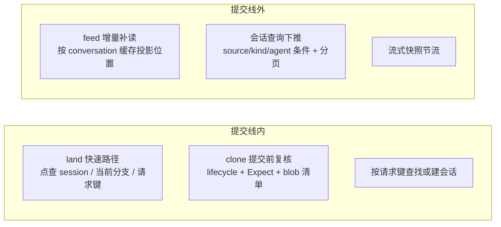
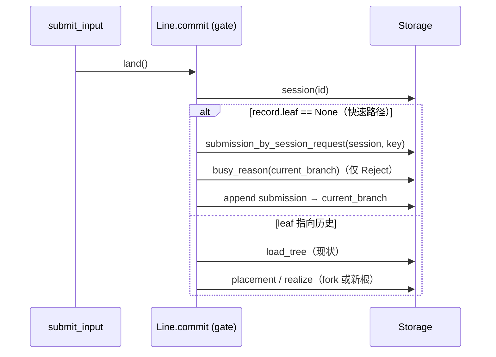

# Session 读写路径优化方案（存储重写之后）

> 状态：**方案，未实施**（2026-10-28）。基线 HEAD `799d5e4f`。
> 与 `docs/storage-durable-perf.md` 的关系：那份是存储层优化清单（P1 上下文读取已做）；本文只收 **Gateway 的 session 层**
> 读写路径。§3.4 / §3.6 与那份 §3、§5 是同一件事，这里给出具体落点，实施时以那份的进度表为准、两边互相引用，不各记一份。
>
> 文中的性能影响全部来自调用链静态分析，**没有实测数字**；并发问题是代码确认的竞争窗口，没有运行时复现。

## 1. 需求背景

### 当前问题

存储换成 pi-durable 提交模型之后，模型上下文读取（P1）已经改成"线上只定边界、线外增量读"。但 session 层还有几条路径保留了
"读全量再过滤"的写法，其中一条在提交线里；另有两处幂等 / 复制的检查不在同一次提交里，存在竞争窗口。

| # | 问题 | 性质 | 代码位置 |
|---|---|---|---|
| A | 每次受理输入都在提交线（全局 `gate`）里 `load_tree`：读 session 全部 conversation + 每个分支的全部 entry | 性能，阻塞其他会话的提交 | `service/durable/submit.rs:400`、`tree.rs:215`、`komo-runtime/src/durable/line.rs:223` |
| B | 建会话的请求键幂等只在进程内表里"先查后写"，并发同键会建两个；重启后失效 | 正确性 | `http/v2/sessions.rs:83`、`:101`；`sessions` 表无请求键列（`komo-store/src/durable/schema.rs:100`） |
| C | `/clone` `/fork` 只在开始时检查源会话，复制 blob 与提交之间不复核；源目录在复制前被 purge 时 `copy_blobs` 静默成功，仍提交引用 blob 的 entry | 正确性（数据完整性） | `service/durable/copy.rs:186`、`:104–108` |
| D | SSE 补读整份投影后才按 `seq > after` 过滤，过滤前还读所有历史 codemode 的外层结果 | 性能，重连成本 O(历史) | `service/durable/feed.rs:137–147`、`nested_view.rs:40` |
| E | 会话列表与按来源找会话全表扫描；渠道的 `ensure_session` 在提交线里扫；列表再逐条串行读 live / inbox / tail | 性能，随会话数线性增长 | `sessions.rs:219`、`:264`、`:325`；`http/v2/sessions.rs:60–69` |
| F | 流式生成每个网络块都构造完整部分消息并再 clone 一次；未收齐的工具参数反复整段���析 | 性能，长回复 / 大参数时 CPU 与分配 | `llm/responses/stateless.rs:193`、`durable/harness/generation.rs:584`、`llm/model_stream.rs:525` |
| G | 模型请求的 `timeout_secs` 是整条请求（含流式正文）的总时限；超时后原样重发同一请求，同样超时，直到 10 次预算用完，每次失败还在会话里留一条空 assistant entry | 可用性，大上下文的会话整轮失败 | `llm/transport.rs:186`、`komo-kernel/src/types/model.rs:260`、`durable/harness/generation.rs:661–699`、`durable/harness/hooks.rs:76` |

A 的展开：`land()` 的闭包在 `Line::commit` 持有 `gate` 期间执行。闭包里先 `load_tree`（分页读全部分支的全部 entry），再按请求键
**逐分支**调 `submission_by_request`，然后 `busy_reason`、`realize`、写 submission。会话越长、分支越多，这次提交持锁越久，
同一进程里所有会话的提交（包括生成的进度提交）都排在它后面。P1 的上下文缓存不经过这条路径。

C 的时序：clone 读完源树 → 另一请求 delete + purge 源会话（目录删掉）→ clone 进入 `copy_blobs`，三个 blob 目录都不存在，
直接返回 `Ok` → 提交新会话，entry 里的 `tool-output/…` 引用指向不存在的文件。现有用例
`clone_copies_entries_and_blobs_and_survives_source_purge`（`session_tests.rs:856`）覆盖的是复制完成**之后**再 purge。

G 的现场（2026-10-28，会话 `01a18089…`，任务 4231）：`send()` 用的是 reqwest 的 `RequestBuilder::timeout`，计时从发请求一直到读完响应体；
没配时 `timeout_secs` 默认 120。这个会话用 `codex/gpt-6.1-sol` 连续失败 23 次，gateway 日志里每次 `elapsed_ms` 都在 120000–120003，
`error=超时`。同一时段 sol 的小请求（memory.extract / title）4–11s 就完成了，近两天 sol 成功的 204 次里最慢的不到 90s，
所以上游没挂，是这个会话的请求在 120s 内跑不完。超时属于 `RetryCause::Transport`（`llm/mod.rs:118`），重发的还是同一份上下文，
结果每次都一样，10 次加上退避一共烧掉约 30 分钟。导出的会话里留下了 10 条 `content: []`、`stopReason: error` 的 assistant entry。
**没法判断**这几次是流一直在吐字节只是总时长超了，还是上游根本没返回数据：komo 不记首字节时间，magpie 代理在本机也没有日志。
临时处置：`~/.komo/config.toml` 的 `[model_providers.magpie]` 已加 `timeout_secs = 600`。

### 目标

- A：`leaf` 跟着当前分支末端（`record.leaf == None`，日常聊天的绝大多数提交）时，`land()` 在提交线里的读取次数与历史长度、
  分支数无关（固定几次点查）。编辑历史、导航后的首次提交仍可走全树。
- B：同一请求键并发 N 次创建只产生一个会话；同键不同内容返回 409；Gateway 重启后同键重发仍返回原会话。
- C：clone / fork 过程中源会话被删除、purge 或改树时，要么返回错误并清掉已复制的目录，要么得到完整副本；不会提交引用缺失 blob 的会话。
- D：客户端带 `after` 重连且投影已在内存时，补读只处理 `after` 之后的新增记录；codemode 外层结果只为要返回的事件读。
- E：按来源找会话改成带条件的查询（走索引），不在提交线里全表扫；会话列表支持分页，单页读取量与总会话数无关。
- F：部分消息快照的构造频率不超过进度发布频率（`partial_interval`，现为 250ms）；工具参数在收齐前不做整段 JSON 解析。
- G：一直在出数据的流不会因为总时长被掐断；上游没数据时仍在一个时限内判成超时。同一请求连续超时，不再把 10 次预算烧完。

### 非目标

- 不改 session 树的用户行为、HTTP 路由形状与 TUI 命令（`docs/session-tree.md`）。
- 不做组提交、Chord delta、deferred 提交（`storage-durable-perf.md` §4、§8 的结论不变）。
- 不改 `/clone` 复制整份 blob 目录的策略（按引用只复制用到的文件是另一件事）。
- 介入答复、Cron、Memory 三路的请求键仍用进程内表（`http/idempotency.rs` 的 TODO），本文只做建会话这一路。

### 术语

- **提交线 / gate**：`Line::commit` 的全局异步锁，所有 durable 提交串行经过它。
- **快速路径**：`record.leaf == None` 时的受理，落点必然是 `current_branch` 末端。
- **投影**：`legacy_events` 把 entry + submission 折成 SSE 事件序列。

## 2. 方案概览

### 整体设计

三件正确性 / 锁内的事（A、B、C）都是"把检查挪进同一次提交、把锁内读改成点查"；三件线外的事（D、E、F）是"只读需要的那段"。
不引入新依赖，存储层只做加列、加索引、加查询条件（schema 只增不改，符合 AGENTS.md 的约束）。

### 核心流程（A：受理输入）

### 实施顺序

| 阶段 | 项 | 理由 |
|---|---|---|
| 1 | C、B、G | 正确性 / 可用性问题，改动小，各自一个测试就能锁住；G 已用配置临时绕开，可排在 C、B 之后 |
| 2 | A | 收益最大，影响所有会话的提交延迟 |
| 3 | E | 渠道入口每条消息都过 `ensure_session`，也在锁内 |
| 4 | D、F | 与 `storage-durable-perf.md` §3、§5 合并实施 |

## 3. 详细设计

### 3.1 A：`land()` 快速路径

- 闭包开头先 `storage.session(id)`、`ensure_open`。`record.leaf.is_none()` 时：
  - 落点直接是 `record.current_branch`，等价于现在的 `placement(&tree, LeafPos::Tail) == Existing(current)`，不需要树。
  - 请求键去重改用新增的 session 级查询（见 §4.1），一次点查代替逐分支循环。
  - `reject_when_busy` 只查 `current_branch` 的 `busy_reason`（现状也只查落点那一个）。
  - sticky model / 标题 / `changed_at` 的更新逻辑不变，只是 `tree.session` 换成刚读的 `record`。
- `record.leaf.is_some()` 维持现状走 `load_tree`。这条路径只在用户导航 / 编辑后的第一次提交出现，之后 `leaf` 被清成 `None`。
- `submit.rs:349` 处线外的请求键预检（同样是 `load_tree` + 逐分支查）一并改成 session 级点查。
- 兼容：快速路径与全树路径必须产出相同的落点与去重结果。用现有 `session_tests` 的受理用例在两条路径上各跑一遍，
  再加一条随机序列等价测试（导航 / 提交 / fork 交替）。

### 3.2 B：建会话幂等落库

- `create` 路由不再用进程内 `Idempotency`；改为调 `DurableCore::create_session_idempotent(spec, key, body_hash)`：
  同一次提交里按请求键查 `sessions`，命中则比 `body_hash`——相同返回原行（`deduplicated`），不同返回
  `SessionError::RequestKeyConflict`；未命中才 `create_in`。
- 闭包先读后写的约束（`ensure_session` 注释里写过）照旧：查询在第一次表写之前。
- 唯一性由 §4.1 的唯一索引兜底：即使将来有绕过这个函数的写入，同键第二次插入也会被存储拒绝成 `Rejected`。

### 3.3 C：clone / fork 提交前复核

- 开始时记下 `Expect::of(&tree)`（`tree.rs` 已有），以及本次要复制的 entry 里引用到的 blob 相对路径集合
  （tool-output / artifacts / payloads 引用；从 entry 里取引用的写法**待确认**，可参考 lifecycle `check_blobs` 对 task 引用的处理）。
- `copy_blobs` 改为：源目录不存在但 blob 清单非空 → 返回 `Conflict("源会话的输出已被清理")`，不再静默成功。
  复制完后逐个确认清单里的文件在暂存目录里存在。
- 提交闭包第一步调 `recheck(storage, source, &expect)`（`tree.rs:380` 已有：核 lifecycle、`current_branch` / `leaf`、全部分支空闲），
  不通过就返回错误；外层照现在的逻辑删掉新目录。
- purge 一侧不加锁：purge 只能从 `deleted` 起步，而复核要求源是 open，所以"复核通过后被 purge"只能发生在提交之后，
  那时副本的 blob 已经独立落盘。

### 3.4 D：SSE 增量补读

与 `storage-durable-perf.md` §3 合并。落点：

- `Feed` 里每个 `SessionFeed` 已有 `projection` 与 `last_seq`。`backfill_with` 先看内存里有没有这个会话的投影、且
  `last_seq >= after`：有就从投影里取 `seq > after` 的事件，不读存储。
- 没有（冷启动、被 `MAX_SESSIONS` 淘汰）才走现在的全量补读，补读完把投影放回缓存。
- `nested_view::load_results` 只对 `seq > after` 的事件里出现的 codemode 结果调用：先算事件、再按需挂结果，
  而不是 `wanted(全部 entry)` 之后再过滤。
- submission 会被改写（状态推进），增量判断用提交的 `seq`，不用 submission ID。

### 3.5 E：会话查询下推

- `SessionQuery` 加可选条件 `source`、`kind`、`agent`；`TursoStorage::scan_sessions` 翻成 `WHERE`，配 §4.1 的索引。
- `main_session` / `session_for_source` 的 `ensure_session` 改用带条件的扫描，`LIMIT 1`、按创建序升序；仍在提交线里，
  但只读命中的一行。
- `list_sessions` 加游标分页（`SessionCursor` 已存在）；`list` 路由按页取，每页的 `session_summary` 用有界并发
  （与 feed 的补读并发上限一样，限在读连接池的一半以内），不无限并发。
- CLI `komo session list` 与 TUI 的会话列表跟着支持翻页；协议加 `cursor` / `next` 字段，旧客户端不带 cursor 时返回第一页。

### 3.6 F：流式快照节流

与 `storage-durable-perf.md` §5 合并。落点：

- `stream_round_trip` 只在距上次发布超过 `partial_interval` 或流结束时调用 `content_so_far()`；中间的块只 `absorb`。
- `generation.rs:584` 的 sink 改存 `Arc<AssistantMessage>`，committer 取最新一份时不再深拷贝。
- `lenient_arguments` 只在对应的工具调用块收到 done 事件后调用；流进行中的参数给界面时传原始字符串。

### 3.7 G：模型请求超时改成空闲时限

- `transport.rs` 的 `send()` 不再调 `builder.timeout()`，改成两段计时：
  - **等响应头**：`tokio::time::timeout(request.timeout, builder.send())`，超时映射成 `TransportError::Timeout`。
  - **读正文**：给 `bytes_stream()` 套一层空闲时限，两次收到数据之间隔超过 `request.timeout` 就报 `Timeout`，一直在收数据就不设总上限。
  - 连接阶段另给一个短的 `connect_timeout`（Client 级，比如 10s），连不上不用等满一个时限。
- `timeout_secs` 的含义从"整条请求最长多久"改成"多久没动静算超时"，不加配置项；`docs/` 里讲配置的地方和 `config.toml` 模板注释同步改。
  G 落地后，`~/.komo/config.toml` 里临时加的 `timeout_secs = 600` 可以删掉。
- 非流式调用（OAuth、`/models` 探测、embedding、typesafe）走的也是这个 `send()`：它们的正文很小，空闲时限和总时限差别不大，行为照旧。
- 重试（`generation.rs:661`）：同一轮生成连续 N 次（暂定 3）都是 `Timeout` 并且一个字节都没收到，就不再重试，直接失败，
  `detail` 写清楚"连续 N 次在 X 秒内没收到数据"。收到过数据再断（`Incomplete` / 空闲超时）照旧走重试预算。
- 失败的尝试不再一次追加一条空 assistant entry：只在最后失败时追加一条；中间几次的错误只记在 `GenerationLive.retry` 里给界面看。
  这会改变导出里 entry 的条数，要和 pi v3 导出的约定核对，**待确认**。
- 观测：`model stream failed` 日志加 `first_byte_ms`（没收到数据就不填）和 `bytes`，以后能分清是"太慢"还是"没响应"。

### 异常处理

- 快速路径读到的 `record` 与全树路径不一致（理论上不会，因为都在 gate 内读已提交状态）：以全树路径为准，加 `debug_assert` 比对一段时间后去掉。
- 建会话请求键冲突：409 `RequestKeyConflict`，与提交输入那一路的语义一致。
- clone 复核失败：409 `Conflict`，文案说清是"源会话被删除"还是"源会话在复制期间被改动"。

## 4. 数据与接口变更

### 4.1 durable.db

| 表 | 变更 | 说明 |
|---|---|---|
| `sessions` | 加列 `request_key TEXT`（可空）、`request_hash TEXT`（可空） | 从 `record.request_key` 抽出成列；新建会话写入，老行留空 |
| `sessions` | 加唯一索引 `sessions_by_request_key (request_key) WHERE request_key IS NOT NULL` | B 的兜底 |
| `sessions` | 加列 `source TEXT`、`kind TEXT`、`agent TEXT`（可空）+ 索引 `(source, kind, lifecycle)` | E 的查询下推；老行启动时一次性回填 |
| `submissions` | 加 session 级请求键查询所需的列或索引（`session_id, request_id`） | A 的一次点查；若 submission 行没有 session 列则经 conversation → session 的映射，**待确认**哪种代价更小 |

均为加列 / 加索引，配 `*_TABLE_DDL` 的字节一致测试；`TableSpec.columns` 同步追加。

### 4.2 接口

| 接口 | 变更 |
|---|---|
| `POST /v1/sessions` | 行为变化：请求键幂等改为持久；同键不同内容 409 `RequestKeyConflict`（字段不变） |
| `GET /v1/sessions` | 新增查询参数 `cursor`（可选）、`limit`（可选，默认 50，**待确认**）；响应新增 `next`（可选） |
| `POST /v1/sessions/{id}/fork` | 新增错误：源会话在复制期间被删除 / 改动 → 409 |
| SSE `/v1/sessions/{id}/events` | 无契约变化；帧序列与现在逐帧相同 |

### 4.3 缓存 / 配置

无新配置项。feed 的投影缓存沿用 `MAX_SESSIONS = 128`。

## 5. 可靠性与安全

### 监控告警

本机单用户 Gateway，不设告警，只加观测（`docs/observability.md` 的 OpenTelemetry，遥测不作事实来源）：

| 观测对象 | 指标 | 用途 |
|---|---|---|
| `Line::commit` | 每次持锁时长直方图，按调用方（land / ensure_session / fork / generation progress）打标签 | 验证 A、E 的锁内时长不再随历史增长 |
| `land()` | 快速路径 / 全树路径命中次数 | 确认快速路径覆盖日常提交 |
| feed 补读 | 缓存命中 / 冷补读次数、冷补读读取的 entry 数 | 验证 D |

具体指标名与 Grafana 面板（`docs/grafana/komo.json`）**待确认**。

### 流量评估

无外部流量。需要在本机补一次基线测量（目前没有数字）：取一个长会话（量级参考旧会话 4661 条事件），测
单次 `land()` 的 gate 持锁时长、另一会话在此期间的提交等待时长、SSE `after = 最新 seq - 10` 的重连耗时。改动前后各测一次，写回 §10 风格的验收记录。

### 降级与兜底

| 场景 | 处理 |
|---|---|
| 快速路径有缺陷 | 保留全树路径；快速路径的入口条件可以一行改成 `false` 回退 |
| feed 投影缓存不一致 | 冷补读仍是事实来源；缓存只是加速 |
| 新列回填失败 | 查询条件为空的老行走原来的全表扫描回退，启动日志报错 |

### 安全合规

不涉及。

## 6. 上线方案

### 发布步骤

1. 阶段 1（C、B）：一个提交一件事，`cargo test --workspace` 通过后 `scripts/install-local.sh`。
2. 阶段 2（A）：先合入带两条路径比对的版本，跑一段时间日常使用，无比对失败后去掉比对。
3. 阶段 3（E）：schema 加列与回填先单独提交，再改查询。
4. 阶段 4（D、F）：按 `storage-durable-perf.md` 的进度推进，完成后在那份 §10 记验收。

### 灰度策略

无（单机自用）。阶段 2 的双路径比对起灰度作用。

### 回滚方案

- 代码：`git revert` 对应提交后重装。
- 数据：只加列、加索引，旧代码忽略新列，可直接回滚代码；唯一索引在旧代码下也只会拒绝同键重复建会话，不影响其他写入。

### 验证计划

| 阶段 | 验证内容 | 方式 |
|---|---|---|
| A | 快速路径与全树路径落点、去重一致；长会话 entry 扫描期间另一会话提交不被阻塞 | 随机序列等价测试；仿 P1 的"分页读取被暂停时另一个 conversation 的提交仍完成"用例 |
| B | 同键并发 20 次只建一个；重启后同键返回原会话；同键不同内容 409 | gateway 测试，起多个并发请求；重开 core 后重发 |
| C | 复制前源目录已 purge → 409 且无残留目录；复制期间源改树 → 409 | 在 `copy_blobs` 前后插入钩子的测试 |
| D | 重连帧与冷补读逐帧相同；缓存命中时不读存储 | 现有 feed 测试加 `after` 变体；计数存储读次数 |
| E | 多 source 下 `session_for_source` 返回最早的 active 会话；分页拼起来等于全量 | 单元测试 + conformance |
| F | 长回复的最终消息与现在逐字节相同；快照构造次数 ≤ 时长 / 250ms + 1 | 脚本化 provider 替身 |
| G | 持续吐数据、总时长超过时限的流能正常完成；两次数据之间停顿超过时限判超时；响应头迟迟不来判超时；连续 N 次没收到数据的超时不再耗完 10 次预算 | 本地起一个按节奏吐 SSE 帧的 HTTP 替身（`ScriptedTransport` 测不到 reqwest 的计时，要走真 socket）；`harness/tests/generation.rs` 加连续超时用例 |
| 全部 | `cargo test --workspace`、`cargo fmt --check` | 本机 |

## 7. 影响范围

- [x] komo-gateway：`service/durable/{submit,sessions,copy,feed,nested_view}`、`http/v2/sessions`
- [x] komo-store：`durable/{schema,storage}`（加列、加索引、查询条件）
- [x] komo-kernel：`SessionQuery` 加条件、`SessionRecord` 抽列、协议加分页字段
- [x] komo-runtime：`llm/responses/stateless`、`llm/model_stream`、`durable/harness/generation`（F）；`llm/transport`、`durable/harness/{generation,hooks}`（G）
- [x] komo-client / TUI：会话列表翻页（仅 E）
- [ ] 上下文推导与压缩（P1 已做的部分不动）
- [ ] 渠道（feishu / telegram / wechat）的对外行为
- [ ] aux.db（cron / deliveries / memory）
- [ ] 导出格式（pi v3 JSONL）

## 待确认

- §4.1 `submissions` 的 session 级请求键查询：加 `session_id` 列，还是经 conversation 映射。
- §3.3 从 entry 里收集 blob 引用的方式。
- §4.2 会话列表默认 `limit`。
- §5 观测指标名与面板。
- 全部性能项的改动前基线数字（需要在本机长会话上实测）。
- G：任务 4231 那 23 次超时到底是流在出数据只是太慢，还是上游没响应——加了 `first_byte_ms` 之后再遇到就能分清。
- G：codex / magpie 上游在模型长时间推理时，会不会超过 120s 一个事件都不发（有没有心跳）。要是会，空闲时限得单独放宽。
- G：日志里主对话的 sol 请求被标成了 `role=memory.model`，像是按模型 ID 反查用途时查到了 `[memory].model`（两边恰好是同一个模型），还没核实。
